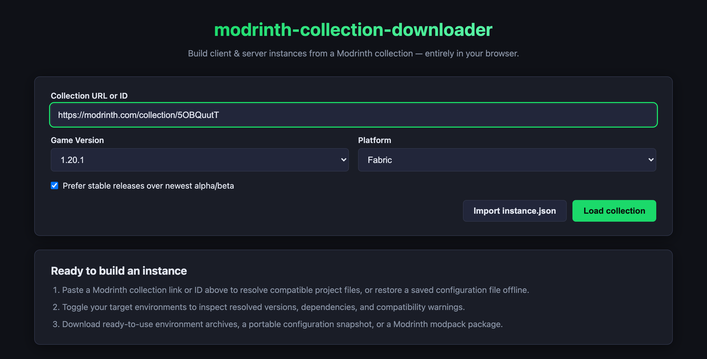
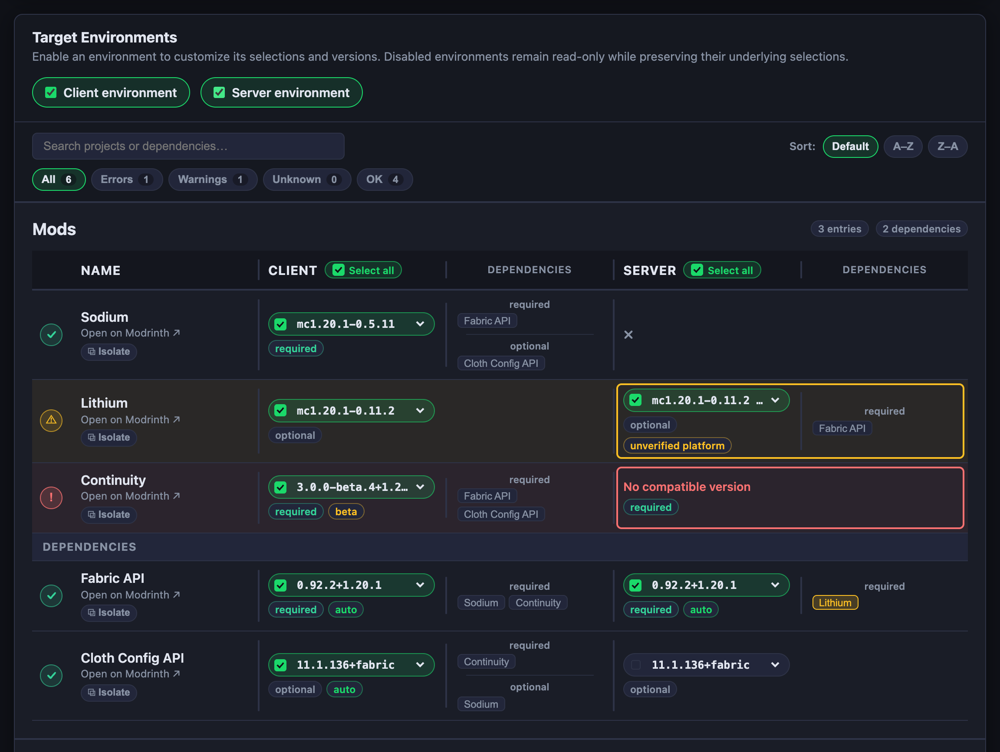
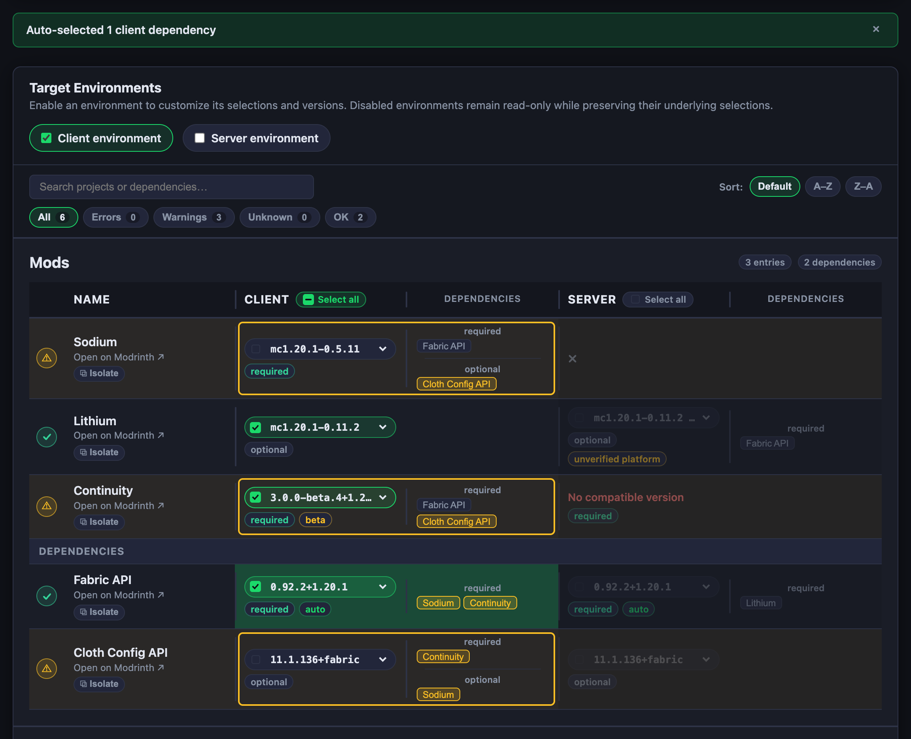
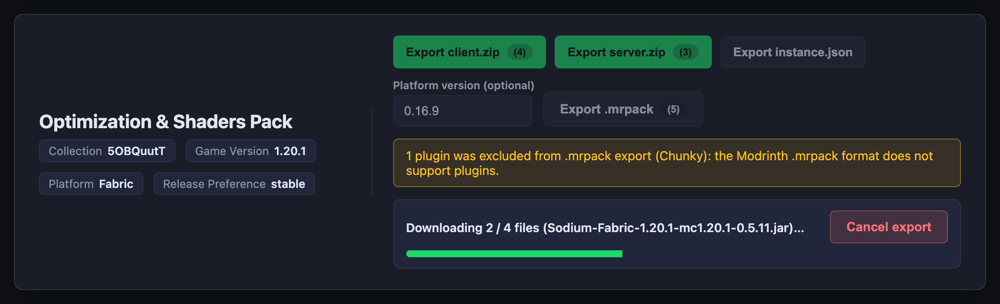

# Modrinth Collection Downloader

A 100% client-side web app to resolve Modrinth collections, manage independent **Client** and **Server** environments, and export ready-to-run Minecraft instances.

Supports:

Modrinth collections are great for sharing lists of projects, but turning them into playable setups can be painful. This app solves those problems in your browser:

1. **Download All Projects at Once:** Instantly download all projects (mods, plugins, datapacks, resource packs, and shaders) listed in a collection.
2. **True Dual-Environment Support:** Client and server have separate mod lists, versions, and dependencies.
3. **Transitive Dependency Closure:** Automatic detection and fetching of required dependencies with cycle protection.
4. **Smart Conflict Detection:** Visible status badges for missing versions, unverified platforms, and version pin conflicts.
5. **Offline Re-import:** A portable `instance.json` format to save and restore complete workspace configurations without downloading.

This app solves those problems in your browser: paste a collection link, pick a Minecraft version and platform, customize client and server environments independently, and export clean `.zip` archives, a Modrinth `.mrpack`, or an offline snapshot.

---

## How It Came to Be

This project started as a standalone derivative of [**DanyCDev/modrinth-collection-web-download**](https://github.com/DanyCDev/modrinth-collection-web-download) ([md.dkg.sk](https://md.dkg.sk/)) by Daniel.

Brainstormed and planned with Claude Sonnet 5.5, and implemented and refined with Gemini 4 Argon in Antigravity.

---

## Visual User Guide

### 1. Load Collection or Import Snapshot



- **Collection URL or ID:** Paste any Modrinth collection link or bare ID.
- **Game Version & Platform:** Filtered to stable releases. Mods and plugins match platform; datapacks, resource packs, and shaders match game version only.
- **Release Preference:** Default **Stable** prefers release versions; uncheck to pick newest alpha/beta.
- **Offline Import:** Click **Import instance.json** to restore any saved workspace instantly with zero network requests.

---

### 2. Unlock Environments & Review Tables



- **Client & Server Toggles:** Start locked (`off`) by default to prevent accidental edits. Turn on the environment(s) you want to build.
- **Per-Type Tables:** Organized into **Mods**, **Plugins**, **Datapacks**, **Resource Packs**, and **Shaders**.
- **Status Indicators:** Red `!` (errors), amber `⚠` (warnings), purple `?` (unknown support), green `✓` (ready). Tooltips explain exact causes per environment.
- **Dependencies Footer:** Transitive dependencies appear at the bottom of each table with `required by: ...` attribution.

---

### 3. Customize Selections & Versions



- **Automatic Dependency Selection:** Checking a mod auto-selects its required dependencies; unchecking auto-deselects them if unneeded.
- **Sticky Overrides:**
  - **User-off stays off:** Manually unchecking a dependency prevents auto-select from re-enabling it (triggers an amber warning instead).
  - **User-on stays on:** Manually checking a dependency keeps it active even if its parent mod is removed.
- **Version Override:** Switch candidate versions in any cell dropdown; dependency trees recompute automatically.

---

### 4. Export Outputs



- **Client & Server Zips (`<id>-client.zip`, `<id>-server.zip`):** Binaries downloaded on demand into `mods/`, `plugins/`, etc., using standardized `{Title}-{Platform}-{GameVersion}-{VersionNumber}.{ext}` naming. Failed downloads report for retry while succeeded files still package cleanly.
- **Modrinth Modpack (`<id>.mrpack`):** Instant metadata manifest (`modrinth.index.json`) referencing Modrinth CDN URLs and hashes. Supports optional loader versions (Fabric, Quilt, Forge, NeoForge).
- **Snapshot JSON (`<id>-instance.json`):** Full, lossless workspace state for offline restore.

---

# Development Guide

## Quickstart

Requires **Node.js 20+** and **Yarn**:

```bash
yarn install     # Install dependencies
yarn dev         # Start local dev server
yarn test        # Run unit, integration, and UI tests
yarn lint        # Run ESLint + boundary checks
yarn typecheck   # Typecheck TypeScript
yarn build       # Build static production bundle into dist/
yarn deploy      # Run lint + typecheck + test + build, then publish ./dist to the gh-pages branch via gh-pages
```

**Deployment (GitHub Pages):** Builds as a portable static bundle with relative asset URLs (`base: './'`). Pushing to `main` automatically triggers CI checks and publishes to GitHub Pages via [`.github/workflows/deploy.yml`](.github/workflows/deploy.yml).

---

## Contributing & Agentic Development

We welcome contributions! Whether you are a human developer or steering an AI coding agent:

- **[`CONTRIBUTING.md`](CONTRIBUTING.md):** Contributor setup, CI verification gates, agentic workflow guide, and checklists for adding platforms or project types.
- **[`AGENTS.md`](AGENTS.md):** System-prompt-optimized routing guide with domain invariants and task playbooks for coding agents.
- **Technical Reference Docs:**
  - [`docs/concepts.md`](docs/concepts.md) — Ubiquitous language, resolution rules, selection state machine, and status tables.
  - [`docs/architecture.md`](docs/architecture.md) — Layer boundaries, ports, UI concurrency, and testing conventions.
  - [`docs/output-formats.md`](docs/output-formats.md) — Archive structures, file naming, and schema specs.
  - [`docs/modrinth-api-notes.md`](docs/modrinth-api-notes.md) — Modrinth API endpoints, batching, and loader classification.

---

## License

Released under the [MIT License](LICENSE).
