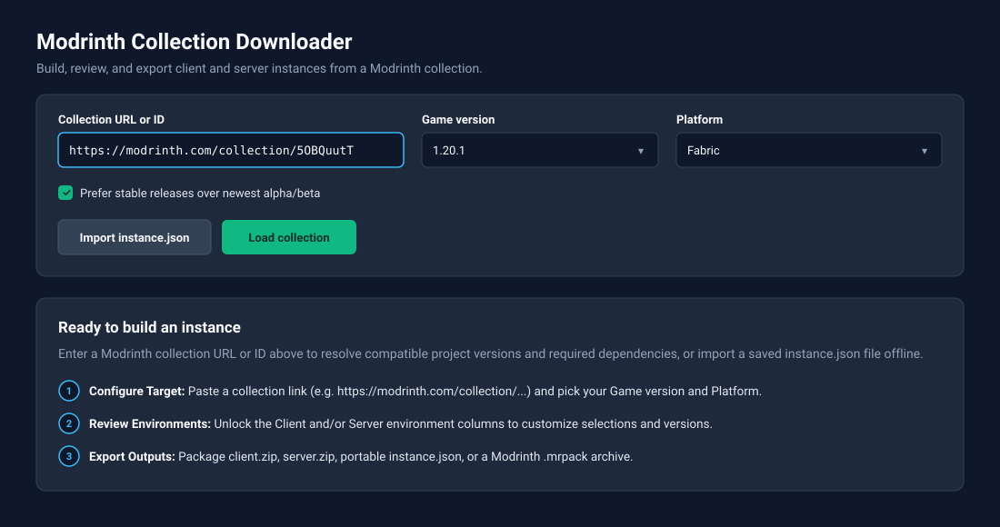
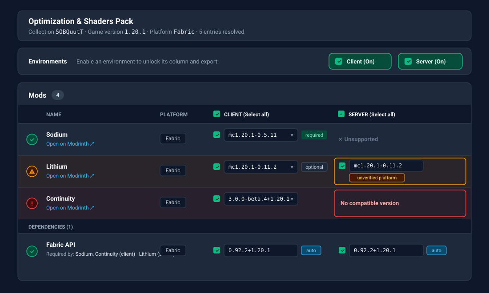
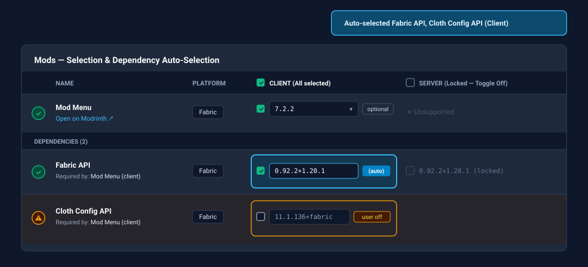
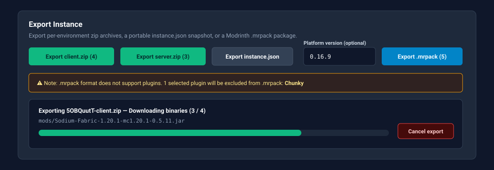

# Modrinth Collection Downloader (`modrinth-collection-downloader`)

A 100% client-side web app for resolving a Modrinth collection against a target **Game Version** and **Platform**, customizing independent **Client** and **Server** **Environments**, and exporting the result as `.zip` archives, portable `instance.json` snapshots, or Modrinth `.mrpack` modpacks.

Built as a standalone derivative of [**DanyCDev/modrinth-collection-web-download**](https://github.com/DanyCDev/modrinth-collection-web-download) ([md.dkg.sk](https://md.dkg.sk/)), re-architected around a single immutable `Instance` model with per-environment dependency closure, status validation, and offline state restore.

---

## User Guide

### 1. Load a Collection or Import `instance.json`



- **Collection URL or ID:** Paste a full URL (`https://modrinth.com/collection/<id>`) or bare collection ID.
- **Game Version & Platform:** Populated from Modrinth release tags. `mod` and `plugin` entries match both **Game Version** and **Platform**; `datapack`, `resourcepack`, and `shader` entries match **Game Version** only.
- **Release Preference:** **Stable** (default) prefers `release` versions over `beta`/`alpha`; uncheck to pick the newest version by `publishedAt` regardless of channel.
- **Progress, Cancel & Retry:** Resolution streams step counts and logs with an active **Cancel** button. Transient `429`/`5xx` errors auto-retry with backoff; if a single project fetch fails, the rest of the collection still resolves and failed projects are listed under **Skipped Projects**.
- **Offline Restore (`Import instance.json`):** Restores a previously exported `<collectionId>-instance.json` workspace immediately with **zero network requests**.

---

### 2. Unlock Environments & Review Tables



- **Client & Server Toggles Start Off:** Both top-level **Environment** toggles default to **off** (locked) on load or import. While off, a column displays its resolved versions and selections grayed out, disables edits and `.zip` export, and suppresses status warnings for that environment. Turning a toggle on unlocks the column without altering underlying selections.
- **Per-Type Tables:** Projects are grouped into **Mods**, **Plugins**, **Datapacks**, **Resource Packs**, and **Shaders**. Required transitive dependencies appear in each table's **Dependencies** footer with `required by: <Project> (<env>)` attribution.
- **Environment Cells:** Each cell shows its selection checkbox, candidate version dropdown (`(beta)`, `(alpha)`, `[unverified platform]`), Modrinth support badge (`required`, `optional`, `unknown`, or `✗` for `unsupported`), and selection-source tag (`auto` or `user off`).
- **Status Badges, Row Tints & Cell Rings:** The leftmost column shows the worst status across **active** environments (`!` red error, `⚠` amber warning, `?` purple unknown, `✓` green OK). Hovering or focusing a badge shows exact `Client:` / `Server:` reasons. Row background tints show the row's overall severity, while outline rings highlight the specific affected environment cell(s).

---

### 3. Customize Selections & Override Versions



- **Auto-Select & Auto-Deselect:** Checking an entry automatically selects (`auto`) its transitive required dependencies in that environment; unchecking it auto-deselects `auto` dependencies no longer needed by any selected entry. Auto-changed cells flash for 1 second alongside a summary toast.
- **Sticky User Overrides:**
  - **User-off stays off:** Manually unchecking a dependency marks it `user off`—subsequent selections or **Select All** will never re-enable it automatically (surfacing an amber warning instead).
  - **User-on stays on:** Manually checking a dependency keeps it selected even if its parent entry is later unchecked.
- **Version Dropdown Override:** Switching a cell's version sets its resolution to `user` and recomputes the dependency closure for that environment only.
- **Target Change Confirmation:** Changing **Game Version**, **Platform**, or **Release Preference** after editing selections prompts before re-resolving and resetting selections to defaults.

---

### 4. Export Archives & Portable Definitions



- **`<collectionId>-instance.json`:** Lossless, schema-validated snapshot of the full `Instance` (selections, candidate pools, chosen versions, dependency graphs). Re-imports offline with zero network calls.
- **`<collectionId>-client.zip` & `<collectionId>-server.zip`:** Enabled when the corresponding **Environment** toggle is on and ≥1 entry is selected. Fetches binaries on demand into `mods/`, `plugins/`, `datapacks/`, `resourcepacks/`, and `shaderpacks/` using `{Title}-{Platform}-{GameVersion}-{VersionNumber}.{ext}` naming. Supports live progress, **Cancel**, and partial-failure packaging (succeeded files still zip; failed files list a **Retry export** action).
- **`<collectionId>.mrpack`:** Instant metadata-only Modrinth modpack (`modrinth.index.json`) referencing CDN URLs and `sha1`/`sha512` hashes. Supports an optional **Platform version** input (`fabric-loader`, `quilt-loader`, `forge`, `neoforge`), splits file entries when `client` and `server` use different versions, and warns when selected `plugin` entries are excluded.

---

## Quickstart & Deployment

Requires **Node.js 20+** and **Yarn**:

```bash
yarn install     # Install dependencies
yarn dev         # Start local Vite dev server
yarn test --run  # Run Vitest suite
yarn lint        # ESLint + architectural boundary checks
yarn typecheck   # tsc --noEmit (strict + noUncheckedIndexedAccess)
yarn build       # Build static production bundle to dist/
```

**GitHub Pages:** `vite.config.ts` uses relative asset paths (`base: './'`) by default (override via `VITE_BASE_PATH`). Pushing to `main` runs [`.github/workflows/deploy.yml`](.github/workflows/deploy.yml), executing all verification gates before deploying `./dist`.

---

## Documentation

- **[`CONTRIBUTING.md`](CONTRIBUTING.md)** — Human developer guide, agentic workflow tips, and checklists for adding a **Platform** or **Project Type**.
- **[`AGENTS.md`](AGENTS.md)** — Compact orientation, task routing table, and guardrails for coding agents.
- **[`docs/concepts.md`](docs/concepts.md)** — Glossary, `Instance` model, resolution order, dependency closure, selection state machine, and status reference.
- **[`docs/architecture.md`](docs/architecture.md)** — Clean architecture layers, ports, UI concurrency/performance invariants, and test rules.
- **[`docs/output-formats.md`](docs/output-formats.md)** — `.zip` naming & collision rules, `instance.json` schema (`schemaVersion: 1`), and `.mrpack` mapping.
- **[`docs/modrinth-api-notes.md`](docs/modrinth-api-notes.md)** — Modrinth API endpoints, `/v2/projects` classification rules, and rate-limit/batching behavior.

---

## License

[MIT](LICENSE)
