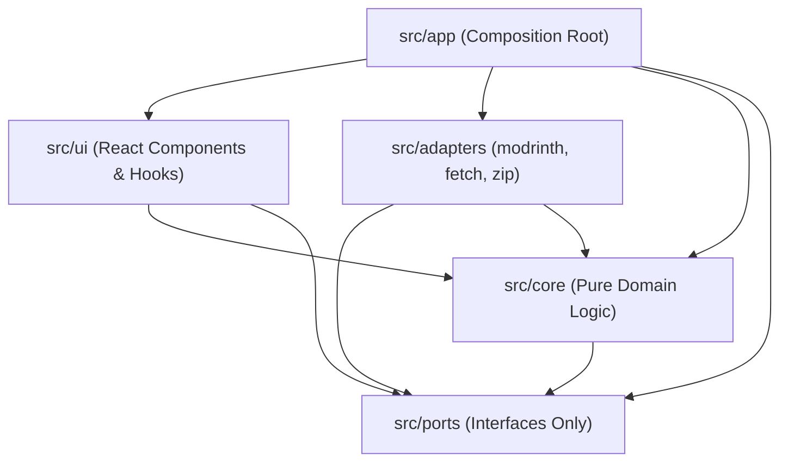

# Architecture

`modrinth-collection-downloader` uses a strict Hexagonal / Clean Architecture so that all domain resolution, dependency closure, selection reducers, status calculation, file naming, and export projections remain 100% pure TypeScript with zero browser, React, or network coupling.

---

## 1. Directory Layout & Layers

```text
src/
  core/       Pure TypeScript domain logic.
              Model types, resolver, dependency closure, selection reducers,
              status engine, file naming, and projections (tables, fileTree,
              instance.json serialization, .mrpack index generation).
              NO React, NO DOM, NO fetch, NO adapters.
  ports/      Pure TypeScript interfaces defining external boundaries.
  adapters/   Concrete implementations of ports:
              - modrinth/ (Modrinth HTTP API client with batching, concurrency limit, retry/backoff)
              - fetch/    (Browser binary file fetcher with AbortSignal support)
              - zip/      (JSZip wrapper implementing ArchiveWriter)
  ui/         React components and hooks. Renders projections from core and dispatches
              actions to core reducers.
  app/        Composition root and app configuration (APP_NAME). Wires concrete
              adapters into core workflows and mounts the UI.
schema/       instance.schema.json (JSON Schema for Instance v1)
docs/         Project documentation
tests/        Recorded API fixtures and integration/boundary tests
```

---

## 2. Import Rules (§5.1)

Architectural boundaries are enforced in CI by ESLint (`eslint-plugin-boundaries`):



| Layer | Allowed Imports | Forbidden Imports |
|---|---|---|
| `src/ports` | `src/core` (domain types only) | `adapters`, `ui`, `app`, React, DOM, JSZip |
| `src/core` | `src/core`, `src/ports` (types only) | `adapters`, `ui`, `app`, React, DOM, `fetch`, JSZip |
| `src/adapters` | `src/ports`, `src/core` (types/utilities) | `ui`, `app`, React |
| `src/ui` | `src/core`, `src/ports` (types) | `src/adapters`, `src/app`, JSZip |
| `src/app` | `src/core`, `src/ports`, `src/adapters`, `src/ui` | _(Composition root)_ |

---

## 3. Ports (§5.2)

All external side effects are abstracted behind three ports in `src/ports/`:

```ts
interface ModrinthClient {
  getCollection(id: string): Promise<{ id: string; name: string; projectIds: string[] }>;
  getProjects(ids: string[]): Promise<ProjectInfo[]>; // batched
  getProjectVersions(
    projectId: string,
    q: { gameVersion: string; platform?: string }
  ): Promise<VersionInfo[]>;
  getVersionsByIds(ids: string[]): Promise<VersionInfo[]>; // batched; for pinned dependency versions
  getGameVersions(): Promise<GameVersionInfo[]>; // /v2/tag/game_version
  getPlatforms(): Promise<PlatformInfo[]>; // /v2/tag/loader
}

interface FileFetcher {
  fetchBinary(url: string, opts?: { signal?: AbortSignal }): Promise<Uint8Array>;
}

interface ArchiveWriter {
  create(): Archive;
}

interface Archive {
  addFile(path: string, data: Uint8Array | string): void;
  generate(opts?: { onProgress?: (pct: number) => void }): Promise<Blob>;
}
```

### Adapter Responsibilities

- **`adapters/modrinth`:** Wraps Modrinth HTTP endpoints, normalizes raw API fields (`loaders` → `platforms`, `client_side`/`server_side` → `environments`), batches ID lookups, caps concurrent requests (default 5), retries `429`/`5xx` responses honoring `Retry-After` and `X-Ratelimit-*` headers, and propagates `AbortSignal`.
- **`adapters/fetch`:** Downloads project binary files into `Uint8Array` buffers with `AbortSignal` support.
- **`adapters/zip`:** Encapsulates `JSZip` behind `ArchiveWriter` / `Archive`. `JSZip` is never imported outside `src/adapters/zip/`.

---

## 4. Data Flow: "One Data, Three Views"

At the center of the application is a single immutable data structure: **`Instance`** (`src/core/model.ts`).

1. **Resolution (`ModrinthClient` → `Instance`):**
   - The resolver fetches collection metadata, project info, compatible versions, and transitive required dependencies per environment (`client` and `server`), producing an initial `Instance`.
2. **State Transitions (`(Instance, Action) => { instance: Instance; changes: Change[] }`):**
   - User interactions (selecting/deselecting an entry in an environment, select-all, overriding a candidate version) are handled by pure core reducers.
   - Reducers return the updated `Instance` along with a `changes` list of auto-selected or auto-deselected cells (which drives the UI flash animation and toast notifications).
3. **Pure Projections (`Instance` → Views & Outputs):**
   - **Review UI Tables:** `toTables(instance): TableModel[]` and `computeStatus(instance)` project the `Instance` into per-type table rows, dependency footers, and per-environment status symbols.
   - **Environment Zip Trees:** `toFileTree(instance): { client: FileTree; server: FileTree }` computes target folder paths, collision-safe filenames, and download URLs for `<collectionId>-client.zip` and `<collectionId>-server.zip`.
   - **Portable JSON:** `serialize(instance): string` and `deserialize(json): Instance` provide lossless, schema-validated `instance.json` export and offline import.
   - **Modrinth Modpack:** `toMrpack(instance, opts): MrpackIndex` projects the `Instance` into a `modrinth.index.json` manifest packaged into `<collectionId>.mrpack`.
