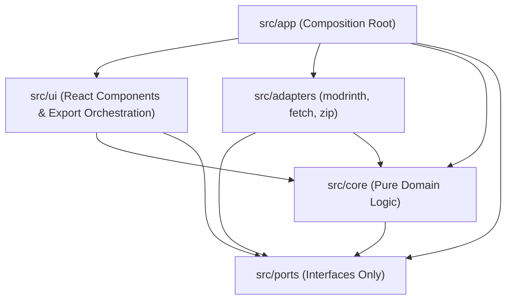

# Architecture & Runtime Invariants

`modrinth-collection-downloader` uses a strict Hexagonal / Clean Architecture so that all domain resolution, dependency closure, selection reducers, status calculation, file naming, and export projections remain 100% pure TypeScript with zero browser, React, or network coupling.

---

## 1. Layers & Import Rules

Architectural boundaries are enforced in CI by ESLint (`eslint-plugin-boundaries` in [`eslint.config.js`](../eslint.config.js)) and tested against synthetic violations in [`tests/boundaries.test.ts`](../tests/boundaries.test.ts).



| Layer | Path | Responsibility & Allowed Imports | Forbidden Imports |
| :--- | :--- | :--- | :--- |
| **`ports`** | [`src/ports/`](../src/ports/) | `ModrinthClient`, `FileFetcher`, `ArchiveWriter` interfaces (`core` types only) | `adapters`, `ui`, `app`, `react`, DOM, `fetch`, `jszip` |
| **`core`** | [`src/core/`](../src/core/) | `model`, `collection`, `resolver`, `reducers`, `status`, `naming`, `projections`, `serialize` (`core` + `ports` types) | `adapters`, `ui`, `app`, `react`, DOM, `fetch`, `jszip` |
| **`adapters`** | [`src/adapters/`](../src/adapters/) | `modrinth/` (API client), `fetch/` (binary downloader), `zip/` (sole `jszip` importer), `http-retry.ts` | `ui`, `app`, `react` |
| **`ui`** | [`src/ui/`](../src/ui/) | `App.tsx`, `download.ts`, `utils.ts`, `styles.css`, and `components/*` (`core` + `ports` types) | `adapters`, `app`, `jszip` |
| **`app`** | [`src/app/`](../src/app/) | `main.tsx`, `services.ts`, `config.ts` (`APP_NAME`) — wires adapters into `ui` | *(Composition root)* |

---

## 2. Ports (`src/ports/index.ts`)

```ts
interface ModrinthClient {
  getCollection(id: string, opts?: RequestOptions): Promise<CollectionInfo>;
  getProjects(ids: string[], opts?: RequestOptions): Promise<ProjectInfo[]>; // batched (100 IDs/call)
  getProjectVersions(projectId: string, q: ProjectVersionsQuery, opts?: RequestOptions): Promise<VersionInfo[]>;
  getVersionsByIds(ids: string[], opts?: RequestOptions): Promise<VersionInfo[]>; // batched; pinned deps
  getGameVersions(opts?: RequestOptions): Promise<GameVersionInfo[]>; // /v2/tag/game_version
  getPlatforms(opts?: RequestOptions): Promise<PlatformInfo[]>; // /v2/tag/loader
}

interface FileFetcher {
  fetchBinary(url: string, opts?: { signal?: AbortSignal }): Promise<Uint8Array>;
}

interface ArchiveWriter {
  create(): Archive; // addFile(path, data) + generate({ onProgress })
}
```

---

## 3. UI Concurrency, Performance & Accessibility Invariants (`src/ui/`)

1. **Synchronous Pre-`Await` Abort & Identity Guards ([`src/ui/App.tsx`](../src/ui/App.tsx)):**
   - Starting collection load (`executeLoadCollection`), file import (`handleImportFile`), version override (`handleChangeEntryVersion`), or archive export (`handleExportEnvironmentZip`, `handleExportMrpack`) **must** abort conflicting `AbortController` refs synchronously before the first `await` (including before `await readFileText(file)`).
   - Guard every post-`await` state update (`try`, `catch`, `finally`, and `onProgress`) with `controllerRef.current === controller && !controller.signal.aborted`.
   - Reset auxiliary session state (`platformVersion`, `zipResult`, `exportError`, `importError`, `flashingCells`, `toastMessage`) on every new collection load or `instance.json` import.
2. **500-Row $O(1)$ Render Isolation ([`src/ui/components/EntryTables.tsx`](../src/ui/components/EntryTables.tsx), [`src/ui/App.tsx`](../src/ui/App.tsx)):**
   - `EntryTableRow` (`areEntryRowPropsEqual`) and `EnvironmentCell` (`areEnvCellPropsEqual`) use `React.memo` with structural equality checks on row data, row status, active environments, and cell flash state, paired with `instanceRef`-stabilized callbacks in `App.tsx`.
   - Toggling a single cell in a 500-row table re-renders only the affected row(s) (verified in [`tests/ui/m5-polish.test.tsx`](../tests/ui/m5-polish.test.tsx)).
3. **Accessibility (`axe-core` & WCAG 2.1 SC 1.4.13):**
   - All UI states must pass `axe-core` with **0 violations** ([`tests/ui/m3-3-status.test.tsx`](../tests/ui/m3-3-status.test.tsx)).
   - [`StatusSymbol`](../src/ui/components/StatusSymbol.tsx) is a keyboard-focusable `<button type="button">` whose tooltip (`role="tooltip"`) dismisses on `Escape` without blurring the trigger and persists across the trigger-to-tooltip hover gap.

---

## 4. Testing Conventions (`tests/`)

1. **`tests/core/*.test.ts` (Pure In-Memory):** Never use `fetch` or real network I/O. Use [`FakeModrinthClient`](../tests/helpers/fake-modrinth-client.ts) (which supports call recording, `AbortSignal`, and `failOn(key, error)` fault injection).
2. **`tests/adapters/*.test.ts` (Recorded Fixtures & Injectable Clocks):** Test against recorded live Modrinth responses in [`tests/fixtures/modrinth/`](../tests/fixtures/modrinth/). Inject deterministic `sleep` and `now` callbacks into `HttpModrinthClient` / `HttpFileFetcher` — never use wall-clock `setTimeout` delays.
3. **`tests/ui/*.test.tsx` (Accessibility & Memo Isolation):** Keep `axe-core` zero-violation assertions, WCAG `Escape` tooltip tests, and the 500-entry render-isolation test green.
