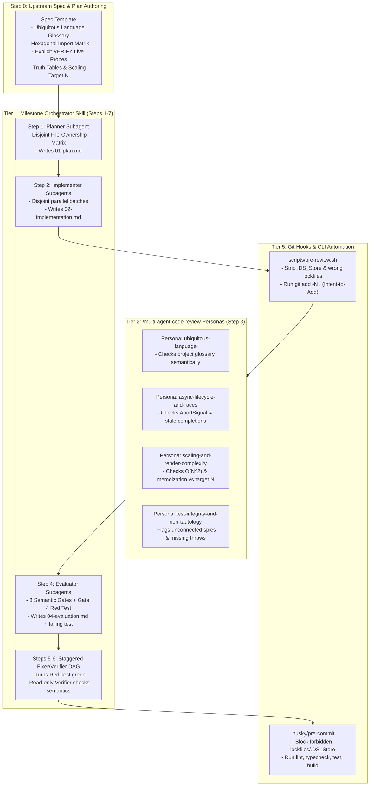
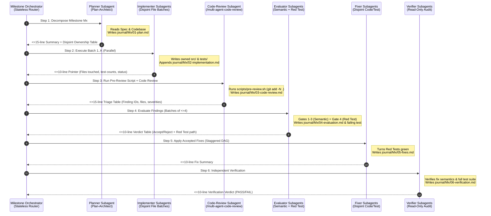
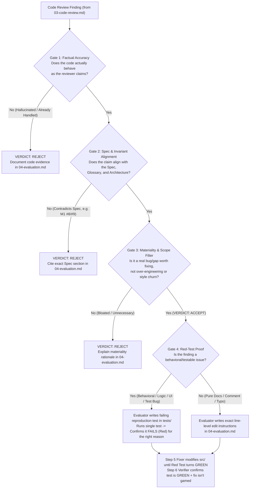
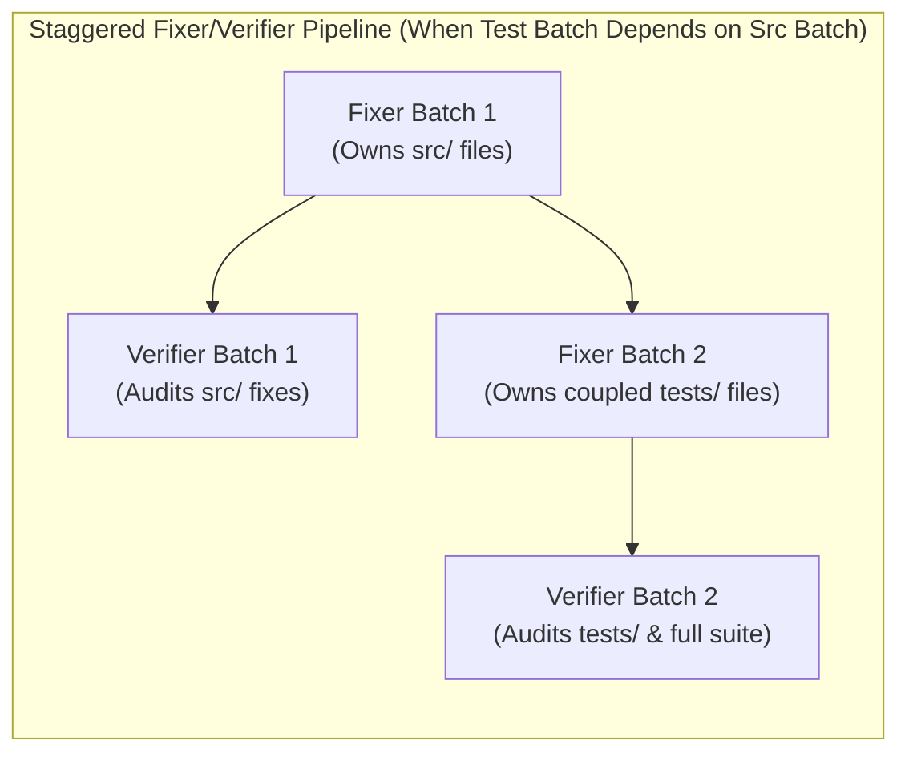

# Autonomous Multi-Agent Execution Retrospective & Workflow Blueprint

> **Purpose:** This document synthesizes the empirical telemetry, architectural insights, failure modes, and workflow optimizations discovered during the one-shot autonomous execution of `modrinth-collection-downloader` across all eight milestones (`M0` through `M5`). It is structured as a **machine-actionable blueprint** for downstream agents and engineers to upgrade the broader agentic coding ecosystem across **Orchestrator Skills, `/multi-agent-code-review` Reviewer Personas, Global & Stack Rules, Git Hooks, CLI Scripts, and Upstream Specification Templates**.

---

## 1. Executive Summary & Classification Taxonomy

### 1.1 One-Shot Execution Telemetry (`M0`–`M5`)

`modrinth-collection-downloader` was built from an empty scaffold to a production-ready, accessible, offline-capable static web application in a **single uninterrupted autonomous session** following [IMPLEMENTATION_PLAN_v1.MD](file:///Users/roda/jd/00-09%20-%20Personal/00%20-%20Code/00.03%20-%20Random%20Software/modrinth-collection-downloader/docs/process/plans/IMPLEMENTATION_PLAN_v1.MD). Every milestone (`M1`–`M5`) executed a structured 7-step multi-agent lifecycle logged in [docs/process/journal/](file:///Users/roda/jd/00-09%20-%20Personal/00%20-%20Code/00.03%20-%20Random%20Software/modrinth-collection-downloader/docs/process/journal/).

| Milestone | Commit | Scope Summary | Subagent Batches (Impl / Eval / Fix / Verify) | Review Findings (Total / Accepted / Rejected) | Cumulative Tests (Suites / Tests) | Journal Directory |
| :--- | :--- | :--- | :--- | :--- | :--- | :--- |
| **`M0` — Foundation** | `2f449e4` | Yarn + Vite + TS (`strict`, `noUncheckedIndexedAccess`), `eslint-plugin-boundaries` + meta-test, JSON Schema Draft 2020-12, docs skeleton, CI workflow | Direct + Verification | N/A (Scaffold gate) | 2 / 4 | [docs/decisions.md](file:///Users/roda/jd/00-09%20-%20Personal/00%20-%20Code/00.03%20-%20Random%20Software/modrinth-collection-downloader/docs/decisions.md#L7-L32) |
| **`M1` — Core** | `ec152b2` | Pure domain model, `ports/`, version resolution (§7.1), transitive dependency closure (§7.2), selection reducers (§7.3), status engine (§7.4), projections, `serialize`/`deserialize` | 4 / 7 / 4 / 4 | **20** (18 Accept / **2 Reject**) | 10 / 177 | [journal/M1](file:///Users/roda/jd/00-09%20-%20Personal/00%20-%20Code/00.03%20-%20Random%20Software/modrinth-collection-downloader/docs/process/journal/M1/) |
| **`M2` — Adapters** | `7ba33f2` | Live Modrinth API `§9 VERIFY` probe, recorded fixtures, `HttpModrinthClient`, `HttpFileFetcher`, `JsZipArchiveWriter`, `http-retry.ts`, E2E resolution tests | 3 / 2 / 3 / 3 | **7** (7 Accept / 0 Reject) | 14 / 215 | [journal/M2](file:///Users/roda/jd/00-09%20-%20Personal/00%20-%20Code/00.03%20-%20Random%20Software/modrinth-collection-downloader/docs/process/journal/M2/) |
| **`M3.1` — UI Tables** | `37a5b34` | `TargetForm`, cancellable `ResolveProgressPanel`, per-type `EntryTables` with dependency footers, `SkippedSection`, `instance.json` export | 2 / 2 / 2 / 2 | **8** (8 Accept / 0 Reject) | 15 / 222 | [journal/M3/M3.1](file:///Users/roda/jd/00-09%20-%20Personal/00%20-%20Code/00.03%20-%20Random%20Software/modrinth-collection-downloader/docs/process/journal/M3/M3.1/) |
| **`M3.2` — Selection** | `a7172dd` | `EnvironmentTogglesBar` (§7.3.1), per-cell selection & version dropdowns, tri-state Select All, `AutoSelectToast`, 1s flash, `ConfirmReResolveDialog` | 2 / 2 / 2 / 2 | **8** (8 Accept / 0 Reject) | 16 / 230 | [journal/M3/M3.2](file:///Users/roda/jd/00-09%20-%20Personal/00%20-%20Code/00.03%20-%20Random%20Software/modrinth-collection-downloader/docs/process/journal/M3/M3.2/) |
| **`M3.3` — Status UI** | `f961f64` | `StatusSymbol` (`✓`, `⚠`, `⚠!`, `?`), WCAG 2.1 SC 1.4.13 tooltips, row tints, cell rings, dual dependency highlighting, `axe-core` suite | 2 / 3 / 2 / 2 | **9** (9 Accept / 0 Reject) | 17 / 233 | [journal/M3/M3.3](file:///Users/roda/jd/00-09%20-%20Personal/00%20-%20Code/00.03%20-%20Random%20Software/modrinth-collection-downloader/docs/process/journal/M3/M3.3/) |
| **`M4` — Outputs** | `02afc4f` | `client.zip`/`server.zip` binary fetch + archive packaging, partial-failure alert, offline `instance.json` import, `.mrpack` export (`modrinth.index.json`) | 2 / 2 / 2 / 2 | **4** (4 Accept / 0 Reject) | 18 / 238 | [journal/M4](file:///Users/roda/jd/00-09%20-%20Personal/00%20-%20Code/00.03%20-%20Random%20Software/modrinth-collection-downloader/docs/process/journal/M4/) |
| **`M5` — Polish** | `81af706` | `formatUserFacingError`, collection & zip retry UX, partial-result resolution (`D-008`), 500-row `React.memo` isolation test, SVG screenshots, GitHub Pages deploy (`D-009`) | 2 / 2 / 2 / 2 | **5** (5 Accept / 0 Reject) | **19 / 252** | [journal/M5](file:///Users/roda/jd/00-09%20-%20Personal/00%20-%20Code/00.03%20-%20Random%20Software/modrinth-collection-downloader/docs/process/journal/M5/) |
| **Total** | **8 Commits** | **100% Spec Parity (§1–§14)** | **61 Subagent Runs** | **61 Total (59 Accept / 2 Reject)** | **19 Suites / 252 Tests** | **49 Journal Artifacts** |

---

### 1.2 Mandatory Classification Taxonomy

To ensure downstream agents route every insight to the right customization layer without polluting global prompts with project-specific trivia, every learning and blueprint item in this report carries **three orthogonal tags**:

#### A. 5-Tier Scope Taxonomy (`Scope Tier`)
- **`Tier 1: Universal Agentic Orchestration & Context Hygiene`** — Applies to any long-running, multi-milestone, multi-agent workflow regardless of domain or programming language (e.g., context window preservation, subagent role scoping, file-pointer return protocols, disjoint file-ownership scheduling).
- **`Tier 2: Multi-Agent Verification & Review Pipelines`** — Applies to code review, finding evaluation, red-test reproduction, batched fixing, and independent verification (e.g., `/multi-agent-code-review` personas, the 4-gate Evaluator protocol, staggered Fixer/Verifier DAGs).
- **`Tier 3: General Software Engineering & Spec-Driven Design`** — Language-agnostic software architecture and specification practices (e.g., Ubiquitous Language glossaries, executable hexagonal boundary meta-tests, live external API `VERIFY` probes, partial-vs-total failure thresholds).
- **`Tier 4: Stack-Specific (Node / TypeScript / React / Vitest / Yarn)`** — Reusable across TypeScript/React/Vitest repositories (e.g., ESM module internal spying limits, `React.memo` referential stability + property-read isolation testing, `AbortController` ref lifecycles, deterministic fake-promise concurrency testing).
- **`Tier 5: Git / GitHub & CI/CD Repository Workflows`** — Reusable across Git/GitHub repositories (e.g., `git add -N .` pre-review intent-to-add staging, `.DS_Store` & lockfile hygiene hooks, pre-commit quality gates, `/generate-pr-description` commit logs).

#### B. 7-Step Milestone Lifecycle Tags (`Lifecycle Step`)
- **`Step 0: Spec & Plan Authoring (Pre-Flight)`**
- **`Step 1: Milestone Decomposition & Planning (01-plan.md)`**
- **`Step 2: Parallel Implementation & Early Testing (02-implementation.md)`**
- **`Step 3: Multi-Agent Code Review (03-code-review.md)`**
- **`Step 4: Finding Evaluation & Red-Test Proof (04-evaluation.md)`**
- **`Step 5: Batched Disjoint Fixing (05-fixes.md)`**
- **`Step 6: Independent Verification (06-verification.md)`**
- **`Step 7: Commit, PR Description & Push (07-commit.md)`**

#### C. Target Customization Primitives (`Target Primitive`)
- **`Orchestrator Skill`** (`SKILL.md` for milestone execution)
- **`Reviewer Persona`** (`/multi-agent-code-review` specialist prompt/lens)
- **`Global Rule`** (`AGENTS.md` / global system instructions)
- **`Workspace/Stack Rule`** (`.agents/rules/` for Node/TS/React or Git)
- **`Git Hook / CLI Tool`** (`.husky/pre-commit`, `scripts/pre-review.sh`)
- **`Spec Template`** (Upstream `IMPLEMENTATION_PLAN` authoring template)
- **`Deterministic Test/Lint Gate`** (ESLint rules, schema validators, meta-tests)

---

### 1.3 Separation of Concerns Across the Agentic Ecosystem

A critical design principle established during post-implementation review is **strict separation of concerns**: never hardcode project-specific rules (such as banning specific words or checking specific UI table components) into general workflow skills. Instead, route each responsibility to the primitive designed for it:



---

## 2. Upstream Implementation Plan Design (`Step 0`) — Why One-Shot Execution Succeeded

- **Scope Tier:** `Tier 3: General Software Engineering & Spec-Driven Design`
- **Lifecycle Step:** `Step 0: Spec & Plan Authoring (Pre-Flight)`
- **Target Primitive:** `Spec Template`, `Deterministic Test/Lint Gate`

### 2.1 High-Leverage Structural Features of `IMPLEMENTATION_PLAN_v1.MD`

Most autonomous multi-milestone agent runs degrade over time due to architectural drift, ambiguous edge cases, or contradictory assumptions across subagents. [IMPLEMENTATION_PLAN_v1.MD](file:///Users/roda/jd/00-09%20-%20Personal/00%20-%20Code/00.03%20-%20Random%20Software/modrinth-collection-downloader/docs/process/plans/IMPLEMENTATION_PLAN_v1.MD) prevented drift through five structural mechanisms that should be standardized in all future implementation plans:

1. **Positive + Negative Ubiquitous Language Table (`§3`)**:
   - Instead of merely naming domain concepts, [IMPLEMENTATION_PLAN_v1.MD §3](file:///Users/roda/jd/00-09%20-%20Personal/00%20-%20Code/00.03%20-%20Random%20Software/modrinth-collection-downloader/docs/process/plans/IMPLEMENTATION_PLAN_v1.MD#L30-L53) explicitly juxtaposed **Canonical Term**, **Meaning**, and **Never call it** (e.g., `Environment` vs. *"side, target, runtime"*; `Platform` vs. *"loader, modloader"*), while explicitly carving out boundary exceptions (e.g., raw external API fields inside `src/adapters/modrinth/`).
   - **General Principle:** Every non-trivial spec should include a **Ubiquitous Language Glossary** with both positive definitions and banned synonyms, plus explicit adapter boundary exceptions.

2. **Executable Hexagonal Boundary Table + Deliberate-Violation Meta-Test (`§5.1` & `M0`)**:
   - [IMPLEMENTATION_PLAN_v1.MD §5.1](file:///Users/roda/jd/00-09%20-%20Personal/00%20-%20Code/00.03%20-%20Random%20Software/modrinth-collection-downloader/docs/process/plans/IMPLEMENTATION_PLAN_v1.MD#L103-L120) defined a 5-row matrix (`core`, `ports`, `adapters`, `ui`, `app`) specifying `May import` and `Must NEVER import`, and required in `M0` (`§13`) that ESLint enforce the rule **and** an automated test prove a deliberate boundary violation fails linting ([tests/boundaries.test.ts](file:///Users/roda/jd/00-09%20-%20Personal/00%20-%20Code/00.03%20-%20Random%20Software/modrinth-collection-downloader/tests/boundaries.test.ts)).
   - **General Principle:** Never rely on prompt instructions alone to maintain layered architecture. Require `M0` to wire a static boundary linter (`eslint-plugin-boundaries`, `dependency-cruiser`, ArchUnit, etc.) **plus a meta-test that runs the linter against a synthetic violating snippet and asserts a non-zero error count**.

3. **Explicit `VERIFY` Pre-Flight Probes for External Systems (`§9`)**:
   - Rather than guessing how an external API behaves, [IMPLEMENTATION_PLAN_v1.MD §9](file:///Users/roda/jd/00-09%20-%20Personal/00%20-%20Code/00.03%20-%20Random%20Software/modrinth-collection-downloader/docs/process/plans/IMPLEMENTATION_PLAN_v1.MD#L510-L529) isolated four explicit `VERIFY` items to be executed against the live API at the start of `M2` before writing adapter code.
   - **Empirical Payoff ([docs/decisions.md D-005 & D-006](file:///Users/roda/jd/00-09%20-%20Personal/00%20-%20Code/00.03%20-%20Random%20Software/modrinth-collection-downloader/docs/decisions.md#L37-L51)):** Live probing in `M2` revealed that Modrinth's `/v3/projects` endpoint omits `client_side`/`server_side` and returns `environment: undefined` for non-mod projects, and that `/v2/projects` returns `project_type: "mod"` even for datapacks and plugins! Had the spec hardcoded v3 assumptions without a `VERIFY` gate, `M2` would have required a major architectural rewrite.
   - **General Principle:** Whenever a project integrates with third-party APIs, CLIs, or browser capabilities, the spec must isolate untested assumptions into a `VERIFY` checklist executed via live probe scripts at the start of the adapter milestone, recording real responses as deterministic test fixtures.

4. **Exhaustive Priority-Ordered Decision Tables (`§7.1`, `§7.3`, `§7.4`)**:
   - Version resolution (`§7.1`), selection state transitions (`§7.3`), and status reason severity (`§7.4`) were specified as priority-ordered tables with explicit state tuples (`(on, source)`).
   - **Empirical Payoff ([journal/M1/04-evaluation.md](file:///Users/roda/jd/00-09%20-%20Personal/00%20-%20Code/00.03%20-%20Random%20Software/modrinth-collection-downloader/docs/process/journal/M1/04-evaluation.md#L16-L17)):** When `M1` code reviewers raised Findings `#8` and `#9` (suggesting that dependency version resolution and `requiredBy` attribution should depend on whether the parent entry is currently selected), the Evaluator subagents immediately cited `§6`, `§7.2`, and `§7.4` to **REJECT** both findings as spec violations.

5. **Concrete Quantitative Scaling Target (`§10` & `§13 M5`)**:
   - Specifying a concrete scaling target (`500 entries` rendering smoothly without layout jank) gave `M3.3` and `M5` a concrete dimension $N = 500$ to optimize and test against.

### 2.2 Spec Gaps Discovered & Resolved in `docs/decisions.md` (`D-001`–`D-009`)

Even a strong spec leaves implementation seams. Analyzing the 9 decisions recorded in [docs/decisions.md](file:///Users/roda/jd/00-09%20-%20Personal/00%20-%20Code/00.03%20-%20Random%20Software/modrinth-collection-downloader/docs/decisions.md) reveals five categories of gaps that future specs (`Step 0`) should address upfront:

| Decision ID | Gap in `IMPLEMENTATION_PLAN_v1.MD` | How It Was Resolved | Upstream Spec Lesson (`Step 0` Template Upgrade) |
| :--- | :--- | :--- | :--- |
| **[`D-001`](file:///Users/roda/jd/00-09%20-%20Personal/00%20-%20Code/00.03%20-%20Random%20Software/modrinth-collection-downloader/docs/decisions.md#L9-L13)** | Package manager not pinned in `§5` (`yarn` vs `npm` vs `pnpm`). Caused a stray `package-lock.json` during `M0` scaffolding. | Standardized on Yarn (`yarn.lock`) and removed `package-lock.json`. | Always pin the exact package manager, lockfile filename, and CLI invocation commands in the Toolchain section. |
| **[`D-005`](file:///Users/roda/jd/00-09%20-%20Personal/00%20-%20Code/00.03%20-%20Random%20Software/modrinth-collection-downloader/docs/decisions.md#L37-L41) & [`D-006`](file:///Users/roda/jd/00-09%20-%20Personal/00%20-%20Code/00.03%20-%20Random%20Software/modrinth-collection-downloader/docs/decisions.md#L43-L51)** | Hybrid project classification (`Terralith` is both mod and datapack; `WorldEdit` is both mod and plugin) when batch project lookup is target-independent. | Established deterministic precedence (`mod` > `plugin` > `datapack`) from `/v2/tag/loader` categories. | When classifying external entities into mutually exclusive domain types, always specify tie-breaking precedence for multi-tag/hybrid entities. |
| **[`D-007`](file:///Users/roda/jd/00-09%20-%20Personal/00%20-%20Code/00.03%20-%20Random%20Software/modrinth-collection-downloader/docs/decisions.md#L53-L60)** | Exact batch chunk size for `?ids=[...]` queries and fallback when CORS hides `X-Ratelimit-*` headers in browser `fetch`. | Chunked at `100` IDs; fallback chain `Retry-After` -> `X-Ratelimit-Reset` -> exponential backoff (`baseDelayMs * 2^attempt`). | Specify URL/batch chunk limits and browser CORS header fallback chains for all HTTP adapters. |
| **[`D-008`](file:///Users/roda/jd/00-09%20-%20Personal/00%20-%20Code/00.03%20-%20Random%20Software/modrinth-collection-downloader/docs/decisions.md#L64-L71)** | `§13 M5` required "partial results" on error, but did not define the boundary between a **partial failure** (degrade gracefully) and a **total failure** (abort & show Retry banner), nor whether fetch-failed root items should enter `entries`. | Defined threshold: `getCollection` failure, initial `getProjects` failure, or 100% version-fetch failure = total error; otherwise omit failed root projects from `entries` and record in `skipped` ([M5 Finding #1](file:///Users/roda/jd/00-09%20-%20Personal/00%20-%20Code/00.03%20-%20Random%20Software/modrinth-collection-downloader/docs/process/journal/M5/04-evaluation.md#L10-L20)). | Whenever a spec asks for "partial failure resilience", explicitly define: (1) the total-failure threshold, and (2) the state invariant for failed items (e.g., `skipped` vs `entries`). |
| **[`D-009`](file:///Users/roda/jd/00-09%20-%20Personal/00%20-%20Code/00.03%20-%20Random%20Software/modrinth-collection-downloader/docs/decisions.md#L73-L77)** | Static hosting subpath portability for GitHub Pages (`/<repo>/` vs `/`). | Configured `base: process.env.VITE_BASE_PATH ?? './'` in `vite.config.ts`. | For static web apps, specify relative asset base paths (`./`) in the deployment section. |

---

## 3. Orchestrator Context Hygiene & Role-Scoped Subagent Architecture (`Tier 1`)

- **Scope Tier:** `Tier 1: Universal Agentic Orchestration & Context Hygiene`
- **Lifecycle Step:** `Steps 1–7 (All Orchestrator Steps)`
- **Target Primitive:** `Orchestrator Skill`, `Global Rule`

### 3.1 Root-Cause Analysis: Why Context Compacted Once in `M4`

During the 8-milestone execution, the primary Orchestrator agent experienced **one context window compaction event** (during Milestone `M4`). Auditing the transcript and journal artifacts shows why:
1. **Inline Step 1 Planning Reads:** Before every milestone (`M1` through `M5`), the Orchestrator read sections of `IMPLEMENTATION_PLAN_v1.MD` and existing source files directly into its own context to write `01-plan.md`.
2. **Verbose Subagent Return Payloads:** Even though subagents wrote `02-implementation.md`, `03-code-review.md`, `04-evaluation.md`, `05-fixes.md`, and `06-verification.md` to disk, their `send_message` replies back to the Orchestrator often repeated 50–150 lines of detailed file diffs, test output tables, and evaluation rationales. Across 61 subagent invocations, those return messages accumulated thousands of tokens in the Orchestrator's conversation history.
3. **Uncompressed CLI Output in Orchestrator Context:** Running `yarn test --run` or `git diff` directly in the Orchestrator accumulated raw console output on every milestone.
4. **Over-Privileged `self` Subagents:** All subagents were spawned using the generic `self` type rather than custom role-scoped definitions via `define_subagent`, requiring longer prompt guardrails on every call.

### 3.2 Four-Part Context Hygiene Architecture

To achieve **zero context compactions** across arbitrarily long multi-milestone runs, the Milestone Orchestrator must operate strictly as a **stateless state-machine router** using four architectural upgrades:



#### Upgrade 1: Delegate Step 1 to a Dedicated `Plan-Architect` Subagent
The Orchestrator must **never** read large codebase files to author `01-plan.md` itself. Instead, at the start of Milestone `Mx`, the Orchestrator invokes a `Plan-Architect` subagent that:
- Reads the relevant section of `IMPLEMENTATION_PLAN.md`, prior milestone `decisions.md`, and current directory tree.
- Designs the **Disjoint File-Ownership Matrix** (ensuring no two parallel Implementer batches touch the same file).
- Writes `docs/process/journal/Mx/01-plan.md`.
- Returns **only** the batch ownership table and a $\le 15$-line summary to the Orchestrator.

#### Upgrade 2: The File-Pointer Return Protocol (`<= 15 Lines`)
Every subagent prompt must enforce a strict **File-Pointer Return Contract**:
> *"Write all detailed analysis, code quotes, and logs to `docs/process/journal/<Milestone>/<StepFile>.md`. Your `send_message` response to the parent Orchestrator MUST NOT exceed 15 lines and must contain only: (1) Status (`PASS`/`FAIL`), (2) Path to the journal file written, (3) Compact bullet/table of file paths or finding verdicts, and (4) Any blocking errors."*

#### Upgrade 3: Role-Scoped Subagents via `define_subagent`
At the start of a multi-milestone run, the Orchestrator should call `define_subagent` once for each of the 6 specialized roles so their system prompts, return-length limits, and tool permissions are baked in:

| Subagent Type Name | `EnableWriteTools` | Write Scope / Behavioral Constraint | Max Return Length |
| :--- | :--- | :--- | :--- |
| `milestone-planner` | `true` | May ONLY write to `docs/process/journal/<Milestone>/01-plan.md`. Must output a strict disjoint file-ownership table per batch. | $\le 15$ lines |
| `milestone-implementer` | `true` | May ONLY create/edit files explicitly listed in its assigned batch + `02-implementation.md` + `docs/decisions.md`. | $\le 10$ lines |
| `milestone-reviewer` | `true` | Runs `scripts/pre-review.sh` (`git add -N .`), executes `/multi-agent-code-review`, writes full report to `03-code-review.md`. | $\le 15$ lines |
| `milestone-evaluator` | `true` | Evaluates $\le 4$ findings via the 4-Gate Protocol. May ONLY write to `04-evaluation.md` and add failing reproduction tests (`Red Tests`) in `tests/`. Never edits `src/`. | $\le 12$ lines |
| `milestone-fixer` | `true` | Implements accepted fixes in assigned files, turns `Red Tests` green, and appends to `05-fixes.md`. | $\le 10$ lines |
| `milestone-verifier` | `true` | **Read-only on `src/` and `tests/`**. Runs verification commands, inspects diffs against `04-evaluation.md`, and writes only to `06-verification.md`. | $\le 10$ lines |

#### Upgrade 4: Quiet Verification Wrapper (`scripts/verify-quiet.sh`)
Instead of streaming 200+ lines of passing Vitest/ESLint output into agent contexts, provide a compact CLI wrapper (`yarn verify:quiet`) that prints a single summary line per check when passing, and dumps full stdout/stderr **only** when a command exits non-zero.

---

## 4. The "Semantic-First, Red-Test-Final" Evaluator Protocol (`Tier 2, Step 4`)

- **Scope Tier:** `Tier 2: Multi-Agent Verification & Review Pipelines`
- **Lifecycle Step:** `Step 4: Finding Evaluation & Red-Test Proof (04-evaluation.md)`
- **Target Primitive:** `Orchestrator Skill`, `Global Rule`

### 4.1 Why Failing Tests Alone Cannot Replace Semantic Evaluation

A tempting simplification in automated workflows is to tell Evaluators: *"Just write a test for every code review finding; if the test fails, accept the finding."*
Our empirical data from `M1` proves why that approach is dangerous:

- **Case Study — `M1` Findings `#8` and `#9` ([journal/M1/04-evaluation.md](file:///Users/roda/jd/00-09%20-%20Personal/00%20-%20Code/00.03%20-%20Random%20Software/modrinth-collection-downloader/docs/process/journal/M1/04-evaluation.md#L16-L17)):**
  - In `M1`, a reviewer flagged `src/core/resolver.ts` (Finding `#8`, P1) and `src/core/projections.ts` (Finding `#9`, P2), arguing that unselected collection entries should not resolve transitive dependencies or populate `requiredBy`.
  - Had an Evaluator blindly written a test asserting `expect(depState.requiredBy).toEqual([])` when the parent was deselected, **that test would have failed (`Red`) against our codebase!**
  - Yet the codebase was **100% right** and the reviewer was **wrong**: [IMPLEMENTATION_PLAN_v1.MD §6](file:///Users/roda/jd/00-09%20-%20Personal/00%20-%20Code/00.03%20-%20Random%20Software/modrinth-collection-downloader/docs/process/plans/IMPLEMENTATION_PLAN_v1.MD#L204) explicitly defines `requiredBy` as *"projectIds of entries whose chosen version in this environment requires this entry (**any selection state**)"*, and `§7.2` / `§7.4` require dependency versions and `REQUIRED_DEPENDENCY_NOT_SELECTED` warnings to be computed properly across the full version closure.
  - Because `M1`'s Evaluators performed semantic spec verification first, they **rejected** Findings `#8` and `#9` and prevented corrupting the core domain model.

### 4.2 Why Semantic Evaluation Alone Is Also Insufficient (The Need for Gate 4 Red Tests)

Conversely, stopping at prose evaluation leaves two vulnerabilities:
1. **Ambiguous Fixer Targets:** The Evaluator has already traced the exact control-flow bug in `src/` and `tests/`, so translating that understanding into prose instructions (`04-evaluation.md`) only for a downstream Fixer to re-derive the test wastes work.
2. **Tautological Test Risk:** If the Fixer writes both the production fix and the test simultaneously in `Step 5`, the Fixer might accidentally write a test that passes even without the fix (as happened in `M4` initial implementation, caught by [M4 Finding #3](file:///Users/roda/jd/00-09%20-%20Personal/00%20-%20Code/00.03%20-%20Random%20Software/modrinth-collection-downloader/docs/process/journal/M4/04-evaluation.md#L7-L16) where `zeroNetworkClient` was asserted against but never passed as a prop to `<App />`, and [M5 Finding #5](file:///Users/roda/jd/00-09%20-%20Personal/00%20-%20Code/00.03%20-%20Random%20Software/modrinth-collection-downloader/docs/process/journal/M5/04-evaluation.md#L90-L106) where `server.zip` retry was untested because `client.zip` was the hardcoded fallback).

### 4.3 The Upgraded 4-Gate Evaluator Protocol

Every Evaluator subagent (`Step 4`) must evaluate each assigned finding (in batches of $\le 4$ findings) through **four sequential gates**:



1. **Gate 1 — Factual Accuracy:** Read the exact lines in `src/` and `tests/`. Does the code actually exhibit the claimed behavior? If not $\rightarrow$ `REJECT`.
2. **Gate 2 — Spec & Architectural Alignment:** Check against `IMPLEMENTATION_PLAN.md`, `docs/decisions.md`, and architectural boundary rules. Does the reviewer's suggestion violate a deliberate design invariant? If yes $\rightarrow$ `REJECT`.
3. **Gate 3 — Materiality & Anti-Overengineering Filter:** Does fixing this prevent a real bug, race condition, accessibility failure, spec violation, or test tautology without introducing unnecessary abstraction? If no $\rightarrow$ `REJECT`.
4. **Gate 4 — Final Red-Test Reproduction (For Accepted Behavioral Findings):**
   - Once a behavioral finding passes Gates 1–3 (`ACCEPT`), the Evaluator **writes the failing reproduction test (`Red Test`)** directly into the appropriate `tests/` file (or adds the missing assertion to an existing test, such as connecting `zeroNetworkClient` in `M4 Finding #3` or asserting `Retry server.zip export` in `M5 Finding #2/#5`).
   - The Evaluator runs `yarn vitest run <test-file>` and **confirms the new test fails (`Red`) for the exact expected reason**.
   - **Why this transforms Steps 5 and 6:**
     - **Step 5 (Fixer):** The Fixer no longer has to guess how to test the bug; the failing test is already sitting in `tests/`. The Fixer modifies `src/` until the Red Test turns **Green** (and all 250+ existing tests remain green).
     - **Step 6 (Verifier):** The Verifier still performs an independent semantic audit of the `src/` and `tests/` diff (ensuring the Fixer didn't trivially hardcode a return value or delete an assertion to make the test pass) **and** verifies the full test suite passes.

---

## 5. Staggered Fixer/Verifier Execution DAG & Risk-Tiered Fast-Tracking (`Tier 1 & 2, Steps 4–6`)

- **Scope Tier:** `Tier 1: Universal Agentic Orchestration & Context Hygiene`, `Tier 2: Multi-Agent Verification & Review Pipelines`
- **Lifecycle Step:** `Step 4: Finding Evaluation`, `Step 5: Batched Disjoint Fixing`, `Step 6: Independent Verification`
- **Target Primitive:** `Orchestrator Skill`

### 5.1 Resolving Cross-File Dependencies Between `src/` and `tests/`

In `M4` and `M5`, we encountered an orchestration subtlety when splitting Fixer batches by file ownership:
- In `M5`, `Fixer Batch 1` owned production files (`src/core/resolver.ts`, `src/ui/components/ExportBar.tsx`, `src/ui/download.ts`, `src/ui/utils.ts` for Findings `#1`–`#4`), while `Fixer Batch 2` owned the test file (`tests/ui/m5-polish.test.tsx` for Finding `#5`).
- Because `Fixer Batch 2`'s new tests directly asserted the fixed behavior of Findings `#1`–`#4` (e.g., `server.zip` retry routing and `Beta Mod` exclusion from the `Mods` table), running `Fixer Batch 2` in parallel with `Fixer Batch 1` would cause `Fixer Batch 2`'s test run to fail until `Fixer Batch 1` finished writing `src/`!
- In `M5`, we solved this by executing a **staggered pipeline**:
  1. Run `Fixer Batch 1` (`src/` changes for Findings `#1`–`#4`).
  2. As soon as `Fixer Batch 1` completes, launch **`Verifier Batch 1` (verifying `src/` changes) AND `Fixer Batch 2` (updating `tests/ui/m5-polish.test.tsx`) in parallel**.
  3. Once `Fixer Batch 2` completes, run `Verifier Batch 2`.



> [!TIP]
> **How Gate 4 (`Red-Test-Final`) Makes This Even Cleaner:**
> When the Evaluator (`Step 4`) writes the failing reproduction tests in `tests/` (partitioned by test file), the test assertions already exist on disk before `Step 5` starts! In `Step 5`, `Fixer` batches only need to edit disjoint `src/` files to turn those tests green, allowing `Fixer` batches across disjoint `src/` modules to run 100% in parallel.

### 5.2 Risk-Tiered Fast-Tracking (Avoiding 4-Subagent Overhead on Typos)

Across `M1`–`M5`, several P3 findings were purely mechanical, zero-risk documentation or annotation updates with 100% reviewer consensus:
- `M1 Finding #19` (P3): Add `@deprecated` JSDoc tags to 3 secondary type aliases in `src/core/model.ts`.
- `M3.1 Finding F-06` (P3): Update 3 line references in `docs/user-guide.md`.
- `M3.3 Finding F-07` (P3): Update `docs/user-guide.md:226` to say `<button type="button">` instead of `tabIndex={0}`.

Running 4 separate subagent hops (`Reviewer -> Evaluator -> Fixer -> Verifier`) for a 1-line documentation sync adds latency without adding safety. The upgraded Orchestrator workflow introduces **Risk-Tiered Fast-Tracking**:
- **Tier A — Full 4-Stage Pipeline (`Review -> Evaluate + Red Test -> Fix -> Verify`):** Mandatory for **all `P0`, `P1`, and `P2` findings**, and any `P3` finding that modifies runtime control flow, state transitions, CSS layout, or test assertions.
- **Tier B — Fast-Track (`Review -> Batch Fix + Verify`):** Permitted **only** for `P3` findings that: (a) touch exclusively markdown documentation (`docs/*.md`), comments/JSDoc, or dead-code removal, (b) have $\ge 90\%$ confidence and zero conflict with the spec, and (c) can be folded into an existing Fixer/Verifier batch.

---

## 6. Separating Domain & Code Concerns into `/multi-agent-code-review` Personas (`Tier 2, Step 3`)

- **Scope Tier:** `Tier 2: Multi-Agent Verification & Review Pipelines`
- **Lifecycle Step:** `Step 3: Multi-Agent Code Review (03-code-review.md)`
- **Target Primitive:** `Reviewer Persona`

During our `/grill-me` retrospective interview, we established a crucial architectural boundary: **code quality lenses (glossary adherence, async cancellation hygiene, scaling complexity, and test non-tautology) do not belong in the Milestone Orchestrator prompt — they belong in specialized `/multi-agent-code-review` Reviewer Personas.**

Below are the four empirical failure classes uncovered across `M1`–`M5` and the generalized, project-agnostic **Reviewer Persona lenses** they motivate:

### 6.1 Persona 1: `ubiquitous-language` (Semantic Domain Glossary Enforcement)
- **Empirical Case Studies:**
  - `M2 Finding F-04` ([journal/M2/04-evaluation.md](file:///Users/roda/jd/00-09%20-%20Personal/00%20-%20Code/00.03%20-%20Random%20Software/modrinth-collection-downloader/docs/process/journal/M2/04-evaluation.md#L21)): `HttpModrinthClient` initially exposed non-port alias methods (`listGameVersions`, `listPlatforms`) and duplicate DTO fields (`projectType`, `dependencyType`) alongside the canonical `§3` / `§5.2` port contract (`getGameVersions`, `getPlatforms`).
  - `M1 Finding #19` ([journal/M1/04-evaluation.md](file:///Users/roda/jd/00-09%20-%20Personal/00%20-%20Code/00.03%20-%20Random%20Software/modrinth-collection-downloader/docs/process/journal/M1/04-evaluation.md#L27)): Secondary type aliases (`DependencyRef`, `SkippedItem`, `FileTreeItem`) coexisted with canonical `§6` types.
- **Why Regex/ESLint Rules Are the Wrong Tool:**
  - Banning substrings like `side` or `loader` via regex/ESLint triggers false positives on legitimate identifiers (`inside`, `sidebar`, ` upside`, `FileLoader`) and cannot distinguish between an internal adapter parser (`src/adapters/modrinth/`) mapping raw external API JSON (`client_side`, `loaders`) and a leaky public domain export (`src/core/`).
- **Generalized Persona Principle:**
  - The `ubiquitous-language` reviewer locates the project's domain glossary (in `IMPLEMENTATION_PLAN.md`, `docs/concepts.md`, or `AGENTS.md`), identifies canonical terms vs. banned synonyms and boundary exceptions, and **semantically** audits exported identifiers, port methods, UI labels, and user-facing documentation for terminology drift or duplicate alias bloat.

### 6.2 Persona 2: `async-lifecycle-and-races` (Cancellation, Stale Completions & State Reset Hygiene)
- **Empirical Case Studies:**
  - `M1 Finding #15` ([journal/M1/04-evaluation.md](file:///Users/roda/jd/00-09%20-%20Personal/00%20-%20Code/00.03%20-%20Random%20Software/modrinth-collection-downloader/docs/process/journal/M1/04-evaluation.md#L23)): `resolveCollection` and `changeEntryVersion` needed `throwIfAborted(opts.signal)` before synchronous work and zero-fetch paths.
  - `M3.1 Finding F-01` & `F-02` ([journal/M3/M3.1/04-evaluation.md](file:///Users/roda/jd/00-09%20-%20Personal/00%20-%20Code/00.03%20-%20Random%20Software/modrinth-collection-downloader/docs/process/journal/M3/M3.1/04-evaluation.md#L9-L11)): `handleLoadCollection` needed `abortControllerRef.current === controller` identity guards on `onProgress`, completion, and `catch` so a superseded request could not overwrite a newer request's state.
  - `M4 Finding #1` & `Finding #2` ([journal/M4/04-evaluation.md](file:///Users/roda/jd/00-09%20-%20Personal/00%20-%20Code/00.03%20-%20Random%20Software/modrinth-collection-downloader/docs/process/journal/M4/04-evaluation.md#L35-L71)): `platformVersion` state leaked across collection loads/imports (`Finding #1`), and `handleImportFile` awaited `readFileText(file)` *before* aborting active controllers (`abortControllerRef`, `versionAbortControllerRef`, `exportAbortControllerRef`) and lacked an `importAbortControllerRef` guard (`Finding #2`).
- **Generalized Persona Principle:**
  - Whenever an async operation (network fetch, file read, archive compression, timer) is triggered in a stateful module or UI component, the `async-lifecycle-and-races` lens verifies four invariants:
    1. **Immediate Pre-Await Cancellation:** In-flight conflicting controllers are aborted *synchronously before the first `await`*, never after an initial async step like `await file.text()`.
    2. **Controller Identity Guard after Every `await`:** Every state mutation in `try`, `catch`, `finally`, and progress callbacks checks `activeControllerRef.current === controller && !controller.signal.aborted`.
    3. **Cross-Workflow State Reset Matrix:** Starting a new primary entity lifecycle (e.g., loading a new document/collection or importing a file) resets all auxiliary derived state from the previous session (like `platformVersion`, `zipResult`, error banners).
    4. **Resource Cleanup in `finally`:** Temporary DOM nodes, `ObjectURL`s (`M3.1 F-04`), and concurrency semaphore slots (`M2 F-07`) are released in `finally` blocks even when synchronous exceptions or aborts occur.

### 6.3 Persona 3: `scaling-and-render-complexity` (Dimension $N$ Discovery & Isolation)
- **Empirical Case Studies:**
  - `M3.3 Finding F-01` ([journal/M3/M3.3/04-evaluation.md](file:///Users/roda/jd/00-09%20-%20Personal/00%20-%20Code/00.03%20-%20Random%20Software/modrinth-collection-downloader/docs/process/journal/M3/M3.3/04-evaluation.md#L9)): Even though `EntryTableRow` was wrapped in `React.memo`, `<App />` passed inline closures referencing `instance` (`onSelect`, `onDeselect`, `onChangeVersion`), and `toTables` / `computeEntryStatus` produced fresh object references (`row`, `cell`, `rowStatus`) on every state change. Without stabilizing callbacks via `instanceRef` and adding value-based `arePropsEqual` comparators, toggling 1 checkbox in a 500-row table re-rendered all 500 rows ($O(N)$ full DOM reconciliation per click).
  - `M5 Finding #5d` ([journal/M5/04-evaluation.md](file:///Users/roda/jd/00-09%20-%20Personal/00%20-%20Code/00.03%20-%20Random%20Software/modrinth-collection-downloader/docs/process/journal/M5/04-evaluation.md#L96-L106)): The initial 500-row performance test only asserted `elapsedMs < 2000` (a wall-clock check that passes in JSDOM even if `React.memo` is completely broken!).
- **Generalized Persona Principle:**
  - Rather than hardcoding React table rules into the general workflow, the `scaling-and-render-complexity` reviewer persona:
    1. Identifies the dominant scaling dimension $N$ for the changed module (e.g., number of entries, graph nodes, events, rows, or batch items) from the spec or domain model.
    2. Audits hot paths for accidental $O(N^2)$ collection scans (e.g., `.includes()` / `.find()` inside `.map()`/`.filter()` loops instead of `Set`/`Map` lookups) or broken memoization boundaries (e.g., `React.memo` / `useMemo` defeated by fresh parent object literals or unstable closures).
    3. Audits performance tests to ensure they assert **structural operation counts** (e.g., render-only property read counts, comparator call counts, or graph visitor counts $< k \ll N$) rather than flaky wall-clock `elapsedMs < X` thresholds alone.

### 6.4 Persona 4: `test-integrity-and-non-tautology` (Falsifiability & Assertion Completeness)
- **Empirical Case Studies:**
  - **Unconnected Mock Spy (`M4 Finding #3`, [journal/M4/04-evaluation.md](file:///Users/roda/jd/00-09%20-%20Personal/00%20-%20Code/00.03%20-%20Random%20Software/modrinth-collection-downloader/docs/process/journal/M4/04-evaluation.md#L7-L16)):** A test constructed `zeroNetworkClient` with `vi.fn()` spies and asserted `expect(zeroNetworkClient.getCollection).not.toHaveBeenCalled()`, but forgot to pass `modrinthClient={zeroNetworkClient}` when rendering `<App />`! The assertion was a pure tautology (`0 === 0`).
  - **Unexercised Test-Title Promise (`M4 Finding #4`, [journal/M4/04-evaluation.md](file:///Users/roda/jd/00-09%20-%20Personal/00%20-%20Code/00.03%20-%20Random%20Software/modrinth-collection-downloader/docs/process/journal/M4/04-evaluation.md#L20-L29)):** A test was titled `it('cleans up temporary anchor and revokes object URL in triggerBlobDownload even if click throws')`, but `clickSpy` was only mocked with a no-op `() => {}` and never mocked to throw.
  - **Hardcoded Fallback Coincidence (`M5 Finding #2` & `#5`, [journal/M5/04-evaluation.md](file:///Users/roda/jd/00-09%20-%20Personal/00%20-%20Code/00.03%20-%20Random%20Software/modrinth-collection-downloader/docs/process/journal/M5/04-evaluation.md#L24-L41)):** `ExportBar.tsx` had a bug where `zipResult.filename.startsWith('server') ? 'server' : 'client'` always evaluated to `'client'` for `<collectionId>-server.zip`. Because the test suite only tested `client.zip` retry (the fallback default!), the bug went undetected until code review.
  - **Missing Negative Companion Assertion (`M1 Finding #7` & `M5 Finding #1/#5`):** In `M5`, the partial-result test verified that failed `Beta Mod` appeared in `Skipped Projects`, but did not assert `expect(within(modsSection).queryByText('Beta Mod')).not.toBeInTheDocument()`, missing that `Beta Mod` was duplicated into both places.
- **Generalized Persona Principle:**
  - The `test-integrity-and-non-tautology` reviewer audits every new or modified test against five falsifiability rules:
    1. **Connected Spy Verification:** Every spy asserted with `.not.toHaveBeenCalled()` must be proven to be wired into the system under test (or verified to be called in a positive control path).
    2. **Title-to-Assertion Parity:** Every condition promised in an `it('...')` description or test comment (e.g., *"even if X throws"*, *"and switches versions offline"*) must have a corresponding executable trigger and assertion in the test body.
    3. **Non-Default Branch Coverage:** Whenever code branches with a ternary fallback (`cond ? 'A' : 'B'`), tests must exercise `'A'` (the non-fallback branch), not just `'B'`.
    4. **Positive + Negative Partition Assertions:** When an item moves from Partition A (e.g., active table entries) to Partition B (e.g., skipped items), tests must assert both `in(B)` **and** `!in(A)`.
    5. **Zero Wall-Clock Sleeps:** Flag `new Promise(r => setTimeout(r, N))` in unit/integration tests (`M2 F-07`); require deterministic deferred promises or fake timers.

---

## 7. General Software Engineering & Stack-Specific Lessons (`Tier 3 & Tier 4`)

### 7.1 Live Dependency `VERIFY` Probes & Recorded Fixtures (`Tier 3, Step 2`)
- **Scope Tier:** `Tier 3: General Software Engineering & Spec-Driven Design`
- **Lifecycle Step:** `Step 2: Parallel Implementation & Early Testing (02-implementation.md)`
- **Target Primitive:** `Workspace/Stack Rule`, `Spec Template`
- **Case Study ([journal/M2/02-implementation.md](file:///Users/roda/jd/00-09%20-%20Personal/00%20-%20Code/00.03%20-%20Random%20Software/modrinth-collection-downloader/docs/process/journal/M2/02-implementation.md)):**
  - Before writing `src/adapters/modrinth/index.ts`, the `M2` adapter subagent executed live `curl`/`fetch` probes against `https://api.modrinth.com` for all four `§9 VERIFY` items, saved trimmed real API responses into `tests/fixtures/modrinth/*.json`, and documented the findings in [docs/modrinth-api-notes.md](file:///Users/roda/jd/00-09%20-%20Personal/00%20-%20Code/00.03%20-%20Random%20Software/modrinth-collection-downloader/docs/modrinth-api-notes.md).
  - Those real fixtures immediately exposed two real-world API quirks that synthetic hand-written mocks would have missed:
    1. Nullable `project_id: null` entries inside `raw.dependencies` on older Modrinth versions ([M2 Finding F-03](file:///Users/roda/jd/00-09%20-%20Personal/00%20-%20Code/00.03%20-%20Random%20Software/modrinth-collection-downloader/docs/process/journal/M2/04-evaluation.md#L13)).
    2. Versions where `files` contains multiple entries or all `primary: false` entries ([M2 Finding F-05](file:///Users/roda/jd/00-09%20-%20Personal/00%20-%20Code/00.03%20-%20Random%20Software/modrinth-collection-downloader/docs/process/journal/M2/04-evaluation.md#L22)).
- **Actionable Principle:** Never write external adapter tests exclusively against hand-crafted mock JSON. Always capture and sanitize real API payloads during the initial `VERIFY` probe and commit them under `tests/fixtures/`.

### 7.2 ESM Intra-Module Spying Limits & Render-Only Property-Read Instrumentation (`Tier 4, Steps 2–5`)
- **Scope Tier:** `Tier 4: Stack-Specific (Node / TypeScript / React / Vitest / Yarn)`
- **Lifecycle Step:** `Step 2: Parallel Implementation`, `Step 4: Finding Evaluation`, `Step 5: Batched Disjoint Fixing`
- **Target Primitive:** `Workspace/Stack Rule`
- **Case Study ([journal/M5/04-evaluation.md Finding 5](file:///Users/roda/jd/00-09%20-%20Personal/00%20-%20Code/00.03%20-%20Random%20Software/modrinth-collection-downloader/docs/process/journal/M5/04-evaluation.md#L98)):**
  - In `M5`, the code reviewer suggested testing `EntryTableRow`'s `React.memo` isolation at 500 rows by calling `vi.spyOn(core, 'formatPlatformDisplayName')`.
  - During `Step 4`, the Evaluator caught a classic ES Module trap: in Vite/Vitest ESM, `EntryTables.tsx` imports `formatPlatformDisplayName` via a direct named ESM binding (`import { formatPlatformDisplayName } from '../../core'`), so `vi.spyOn(coreNamespace, 'formatPlatformDisplayName')` cannot intercept calls without `vi.mock()`, which would affect the entire test file.
  - Furthermore, spying on a function called inside `toTables()` or `areEntryRowPropsEqual()` would count calls made during data projection or memo comparison rather than actual component rendering!
  - **The Solution ([tests/ui/m5-polish.test.tsx:771-845](file:///Users/roda/jd/00-09%20-%20Personal/00%20-%20Code/00.03%20-%20Random%20Software/modrinth-collection-downloader/tests/ui/m5-polish.test.tsx#L771-L845)):** Instrument a **render-only property getter** on the input data objects using `Object.defineProperty` (specifically `VersionRef.versionType`, which is read inside `EnvironmentCell` during JSX rendering, but is **not** read by `deselectEntry`, `toTables`, `computeEntryStatus`, or `areEntryRowPropsEqual`). On initial render of 500 rows, the getter recorded `1000` reads (`500` rows $\times$ `2` environments). After resetting the counter and toggling 1 row (`proj-0`), the getter recorded **only `4` reads** (`proj-0` and its single dependent `proj-450`), deterministically proving $O(1)$ `React.memo` isolation without flaky timers or brittle module mocks.

---

## 8. Git Hooks, Pre-Review `git add -N .`, and Deterministic Commit Gates (`Tier 5, Steps 3 & 7`)

- **Scope Tier:** `Tier 5: Git / GitHub & CI/CD Repository Workflows`
- **Lifecycle Step:** `Step 3: Multi-Agent Code Review`, `Step 7: Commit, PR Description & Push`
- **Target Primitive:** `Git Hook / CLI Tool`, `Orchestrator Skill`

### 8.1 The Untracked-File Blindspot in Diff-Based Code Review (`Step 3`)

- **Empirical Incident (`M1`–`M5` Step 3 Reviews):**
  - Most automated code review tools (including `/multi-agent-code-review`) inspect working-tree changes via `git diff HEAD` or `git diff --stat HEAD`.
  - In Git, **newly created untracked files (`??` in `git status`) are completely omitted from `git diff HEAD` unless they are staged or marked with intent-to-add (`git add -N .`)!**
  - Because every milestone created brand-new implementation and test files (e.g., `src/ui/components/ExportBar.tsx`, `tests/ui/m4-outputs.test.tsx`, `tests/ui/m5-polish.test.tsx`), running `git diff HEAD` without `git add -N .` would have caused the review pipeline to see **only edits to existing files (`App.tsx`) while being 100% blind to all newly created components and test files!**
  - Additionally, macOS Finder/Spotlight intermittently created `.DS_Store` files inside `docs/process/journal/` during the run, and an early `npx` invocation in `M0` briefly generated a `package-lock.json` in a Yarn repository (`D-001`).

### 8.2 Two-Stage Git Automation (`scripts/pre-review.sh` + `.husky/pre-commit`)

Instead of relying on agents to remember `git add -N .` or manually clean up `.DS_Store` files, we codify this into two deterministic scripts that any project can drop in:

1. **`scripts/pre-review.sh` (Invoked automatically at the start of `Step 3: Code Review`)**:
   - Deletes any `.DS_Store` files across the working tree.
   - Checks lockfile consistency (fails or removes stray `package-lock.json` / `pnpm-lock.yaml` when `yarn.lock` is canonical).
   - Runs `git add -N .` so every newly created file is tracked with an empty index entry and appears in full inside `git diff HEAD`.
   - Prints `git status -s` and `git diff HEAD --stat` so the reviewer subagent has an exact manifest of changed files and line counts.

2. **`.husky/pre-commit` (or `.git/hooks/pre-commit`, triggered automatically on `git commit` in `Step 7`)**:
   - Automatically unstages and deletes `.DS_Store` files if any were accidentally staged.
   - Rejects commits containing forbidden lockfiles (`package-lock.json`) or unresolved conflict markers.
   - Runs the project's deterministic verification suite (`yarn verify:quiet` $\rightarrow$ `lint`, `typecheck`, `test`, `build`).
   - **Workflow Integration Note:** When `.husky/pre-commit` is active in a repository, the Orchestrator's `Step 7` does **not** need to run `yarn lint && yarn typecheck && yarn test && yarn build` manually a second time after `Step 6` verification — `git commit` enforces the gate automatically and atomically.

---

## 9. Concrete Machine-Actionable Blueprints (Copy-Pasteable Specs for Downstream Agents)

This section provides complete, self-contained templates and specifications that downstream agents can directly install into `.agents/skills/`, `.agents/rules/`, `scripts/`, and `.husky/`.

---

### 9.1 Blueprint A: Upgraded Milestone Orchestrator Skill (`SKILL.md`)

- **Target Path:** `~/.agents/skills/milestone-orchestrator/SKILL.md` (or `.agents/skills/milestone-orchestrator/SKILL.md`)
- **Scope Tier:** `Tier 1` & `Tier 2` (`Steps 1–7`)
- **Target Primitive:** `Orchestrator Skill`

````markdown
---
name: milestone-orchestrator
description: Execute a multi-milestone implementation plan end-to-end with strict context hygiene, role-scoped subagents, 4-gate semantic+red-test evaluation, staggered fixer/verifier DAGs, and structured implementation journaling.
---

# Milestone Orchestrator Skill

Use this workflow when executing one or more milestones from an authoritative implementation plan (e.g., `IMPLEMENTATION_PLAN.md`).

## Core Operating Principles (Stateless Router Rules)

1. **Protect Orchestrator Context at All Costs:**
   - Do NOT read large source files or full journal logs into the main orchestrator context.
   - Delegate planning, implementation, review, evaluation, fixing, and verification to role-scoped subagents.
   - Enforce the **File-Pointer Return Contract** on every subagent call: subagents write full details to `docs/process/journal/<Milestone>/0X-*.md` and reply via `send_message` with **at most 15 lines** containing only status, file paths, and a compact summary table.
2. **Enforce Disjoint File Ownership:**
   - Never run two write-enabled subagents in parallel if their file ownership sets overlap (`src/` or `tests/`).
   - Shared append-only files (`docs/decisions.md` or journal logs) must either be assigned to a single batch or written to per-batch sections merged after completion.

---

## Pre-Flight: Role-Scoped Subagent Definitions (`define_subagent`)

Before starting the first milestone, define the following role-scoped subagent types via `define_subagent`:

1. `milestone-planner`:
   - Purpose: Reads the spec and codebase for Milestone `Mx`, runs any pre-flight `VERIFY` probes, designs disjoint implementation batches, and writes `docs/process/journal/<Mx>/01-plan.md`.
   - Return limit: `<= 15 lines` (Disjoint file ownership table + key verification notes).
2. `milestone-implementer`:
   - Purpose: Implements assigned batch files and unit/integration tests, runs `yarn verify:quiet`, and appends its batch log to `docs/process/journal/<Mx>/02-implementation.md`.
   - Return limit: `<= 10 lines` (Files modified, test count, gate status).
3. `milestone-reviewer`:
   - Purpose: Runs `scripts/pre-review.sh` (ensuring `git add -N .` marks all new files for diffing), executes `/multi-agent-code-review`, and writes `docs/process/journal/<Mx>/03-code-review.md`.
   - Return limit: `<= 15 lines` (Markdown table of findings: `#`, `Priority`, `File:Line`, `One-line summary`).
4. `milestone-evaluator`:
   - Purpose: Evaluates a batch of `<= 4` findings from `03-code-review.md` using the **4-Gate Semantic-First, Red-Test-Final Protocol**, writes `docs/process/journal/<Mx>/04-evaluation.md`, and adds failing reproduction tests (`Red Tests`) in `tests/` for accepted behavioral findings.
   - Return limit: `<= 12 lines` (Table of Finding `#`, `ACCEPT/REJECT`, target `src/` files, and `Red Test` file/name).
5. `milestone-fixer`:
   - Purpose: Implements accepted fixes in assigned files, turns `Red Tests` green, runs `yarn verify:quiet`, and writes `docs/process/journal/<Mx>/05-fixes.md`.
   - Return limit: `<= 10 lines` (Findings fixed, files touched, test status).
6. `milestone-verifier`:
   - Purpose: **Read-only on `src/` and `tests/`**. Audits fixer diffs against `04-evaluation.md` (ensuring tests were not gamed or weakened), runs full verification gates, and writes `docs/process/journal/<Mx>/06-verification.md`.
   - Return limit: `<= 10 lines` (Per-finding `VERIFIED`/`FAILED` status + suite summary).

---

## The 7-Step Milestone Execution Loop

For each Milestone `Mx`:

### Step 1: Milestone Decomposition & Planning (`01-plan.md`)
- Invoke `milestone-planner` for `Mx`.
- Require `01-plan.md` to include:
  1. Spec sections covered & any `VERIFY` live probes executed.
  2. **Disjoint Batch Ownership Table** (`Batch ID`, `Owned src/ files`, `Owned tests/ files`, `Dependencies`).
  3. Acceptance criteria checklist.

### Step 2: Parallel Implementation & Early Testing (`02-implementation.md`)
- Spawn `milestone-implementer` subagents in parallel for all independent batches (and sequentially for batches that depend on prior foundation batches).
- Every batch must write comprehensive unit/integration tests alongside production code and pass `lint`, `typecheck`, `test`, and `build` before returning.

### Step 3: Multi-Agent Code Review (`03-code-review.md`)
- Run `scripts/pre-review.sh` (or `git add -N .` + `.DS_Store`/lockfile check) so **all newly created files are visible to `git diff HEAD`**.
- Invoke `milestone-reviewer` using `/multi-agent-code-review` (with `ubiquitous-language`, `async-lifecycle-and-races`, `scaling-and-render-complexity`, and `test-integrity-and-non-tautology` lenses).
- Write the full report to `docs/process/journal/<Mx>/03-code-review.md`.
- If `0` findings are reported, proceed directly to `Step 7`.

### Step 4: 4-Gate Finding Evaluation & Red-Test Proof (`04-evaluation.md`)
- Partition findings into batches of `<= 4` findings with disjoint `tests/` ownership.
- **Fast-Track Exception:** Purely mechanical `P3` doc/comment/JSDoc fixes with 100% consensus and zero runtime impact may skip standalone evaluation and be folded directly into a Fixer batch.
- For all `P0`–`P2` and behavioral `P3` findings, invoke `milestone-evaluator` subagents to apply the **4-Gate Protocol**:
  - **Gate 1 (Factual Accuracy):** Verify against actual lines in `src/` and `tests/`. If false -> `REJECT`.
  - **Gate 2 (Spec & Invariant Alignment):** Verify against `IMPLEMENTATION_PLAN.md` and `docs/decisions.md`. If it contradicts the spec -> `REJECT`.
  - **Gate 3 (Materiality Filter):** Confirm it fixes a real bug, race, edge case, or test tautology without over-engineering. If not -> `REJECT`.
  - **Gate 4 (Final Red-Test Reproduction):** For every `ACCEPT`ed behavioral finding, the Evaluator writes a minimal **failing reproduction test (`Red Test`)** in `tests/` and runs Vitest on that file to prove it **fails (`Red`)** for the expected reason before `src/` is fixed.

### Step 5 & Step 6: Staggered Disjoint Fixing (`05-fixes.md`) & Independent Verification (`06-verification.md`)
- Group `ACCEPT`ed findings into disjoint Fixer batches (`<= 4` findings per batch).
- **Execution Topology:**
  - **Case A (Evaluator already wrote the failing test in `Step 4`, or Fixer batches have completely disjoint `src/` + `tests/` files):** Run `milestone-fixer` batches in parallel; as each Fixer batch finishes, immediately launch its corresponding `milestone-verifier` batch.
  - **Case B (A test-only Fixer Batch 2 depends on production changes in `src/` Fixer Batch 1):** Run `Fixer Batch 1 (src/)` first -> once complete, run `Verifier Batch 1 (src/)` AND `Fixer Batch 2 (tests/)` in parallel -> once `Fixer Batch 2` completes, run `Verifier Batch 2 (tests/)`.
- If any `milestone-verifier` reports a failure, loop back to `milestone-fixer` for that batch until 100% verified.

### Step 7: Commit, PR Description & Push (`07-commit.md`)
- Generate the structured commit/PR description following the `/generate-pr-description` format (`# Title`, `## Overview` with `✨`, `## Highlights` with `✨`, and collapsible `<details><summary><b>Changelog</b></summary>` separating `### Implementation Changes` and `### Test Changes`).
- Save to `docs/process/journal/<Mx>/07-commit.md`.
- Stage all files (`git add -A`), verify `git status` contains no `.DS_Store` or stray lockfiles, commit using `git commit -F`, and push to origin. (If `.husky/pre-commit` is installed, it will automatically enforce `lint`, `typecheck`, `test`, and `build` during commit.)
````

---

### 9.2 Blueprint B: `/multi-agent-code-review` Specialist Persona Specifications

- **Target Path:** Integrate into `/multi-agent-code-review` specialist prompts (e.g., `~/.agents/skills/multi-agent-code-review/references/personas/`)
- **Scope Tier:** `Tier 2: Multi-Agent Verification & Review Pipelines` (`Step 3`)
- **Target Primitive:** `Reviewer Persona`

````markdown
# Specialist Reviewer Personas for `/multi-agent-code-review`

## 1. Persona: `ubiquitous-language` (Domain Glossary & Boundary Fidelity)

**Trigger:** Always run when the repository contains a domain glossary (in `IMPLEMENTATION_PLAN.md`, `docs/concepts.md`, `README.md`, or `AGENTS.md`).

**Instructions:**
1. Locate the project's **Ubiquitous Language Glossary** (canonical terms, banned synonyms, and explicit adapter boundary exceptions).
2. Audit all changed files in `core/`, `ports/`, `ui/`, and `docs/` semantically (do NOT flag coincidental English substrings like `inside` or `sidebar`):
   - **Exported Symbols & Types:** Do new types, interfaces, functions, and enum variants use the canonical domain terms rather than banned synonyms?
   - **Port & Adapter Boundary:** Do adapter modules translate external API terminology into canonical domain types at the boundary without leaking raw third-party field names or duplicate alias methods into `ports/` or `core/`?
   - **UI & Documentation Parity:** Do user-visible labels, tooltips, error banners, and markdown docs use the exact canonical terms defined in the glossary?

---

## 2. Persona: `async-lifecycle-and-races` (Cancellation, Concurrency & State Reset Hygiene)

**Trigger:** Run when the diff introduces or modifies `async`/`await` functions, `fetch`/file I/O, timers, `AbortController`, or stateful UI handlers.

**Instructions:**
1. **Immediate Pre-Await Cancellation:** When an async handler starts a new operation that supersedes prior operations (e.g., loading a resource, importing a file, exporting an archive), verify that prior `AbortController` refs are aborted and in-flight state flags are reset **synchronously before the first `await`** (never after an initial `await readFile()` or `await fetch()`).
2. **Controller Identity Guards After Every `await`:** Verify that after every `await` in `try`, `catch`, `finally`, and streaming `onProgress` callbacks, the handler checks `controllerRef.current === controller && !controller.signal.aborted` before mutating state or clearing shared loading flags (`isExporting`, `isResolving`).
3. **Cross-Session State Reset Matrix:** Trace all component/store state variables. When the primary workspace entity is replaced (e.g., loading a new document, re-resolving, or importing a file), verify that every auxiliary state variable tied to the old entity (e.g., optional form overrides, previous export results, stale error banners, flash timers) is explicitly reset.
4. **Exception-Safe Resource Cleanup:** Verify that temporary DOM elements (`<a download>`), `URL.createObjectURL` blobs, timers, and concurrency queue slots are cleaned up inside `try ... finally` blocks even if synchronous DOM calls (`anchor.click()`) or stream reads (`response.json()`, `response.arrayBuffer()`) throw.

---

## 3. Persona: `scaling-and-render-complexity` (Critical Dimension $N$ & Memoization Isolation)

**Trigger:** Run when the diff modifies data projections, graph/closure algorithms, collection loops, or list/table rendering components.

**Instructions:**
1. **Identify Critical Dimension $N$:** Determine the primary scaling dimension $N$ of the module (e.g., number of collection entries, dependency graph edges, table rows, or batch IDs) and any target scale specified in the plan (e.g., $N = 500$).
2. **Algorithmic Complexity ($O(N)$ vs $O(N^2)$):** Flag nested `.find()`, `.includes()`, or `.filter()` calls inside loops over $N$ items where a pre-indexed `Map` or `Set` should be used.
3. **Render & Memoization Isolation:** When list/row components use `React.memo` (or selector memoization), verify both:
   - **Callback Stability:** Parent callbacks passed as props do not close over rapidly changing state objects without a ref (`instanceRef`) or `useCallback`.
   - **Value-Based Comparator Completeness:** If projections create new row/cell wrapper objects on each state transition, verify that `React.memo(Component, arePropsEqual)` compares underlying primitive/reference values accurately without ignoring fields that affect rendering.
4. **Performance Test Audit:** If the diff includes a performance test for dimension $N$, flag tests that rely solely on wall-clock timing (`elapsedMs < 2000`). Require deterministic structural assertions (e.g., counting render-only property reads or component render invocations on a single-item mutation and asserting `reads <= k` where $k \ll N$).

---

## 4. Persona: `test-integrity-and-non-tautology` (Falsifiability & Assertion Audit)

**Trigger:** Run whenever `tests/` files are added or modified.

**Instructions:**
Audit every test in the diff against five falsifiability failure modes:
1. **Unconnected Spy Tautology:** For every `expect(spy).not.toHaveBeenCalled()` assertion, trace `spy` back to its creation. Verify that the mock/spy object was actually injected into the component or function under test. An unconnected spy is a `P1/P2` tautology.
2. **Test Title / Comment Promise Gap:** Compare every `describe` / `it('...')` title and inline test comment against the actual assertions in the test body. Flag any test whose title claims to test a condition (e.g., *"even if click throws"*, *"and switches versions offline"*, *"disables button when locked"*) that is never triggered or asserted.
3. **Fallback Coincidence Blindspot:** When production code computes a value with a default fallback (e.g., `cond ? 'server' : 'client'`), check whether the test suite only tests the fallback value (`'client'`). Require a test exercising the non-default branch (`'server'`).
4. **Missing Negative Partition Assertion:** When an operation moves or filters an item from Set A (e.g., active review table) into Set B (e.g., skipped projects list), verify that the test asserts **both** presence in Set B **and** absence from Set A (`expect(queryByText(...)).not.toBeInTheDocument()`).
5. **Wall-Clock Sleep Ban:** Flag any `new Promise(r => setTimeout(r, ms))` used to wait for async state or concurrency ordering; require deterministic deferred promises or fake timers.
````

---

### 9.3 Blueprint C: Git Hooks & CLI Automation Scripts (`Tier 5`)

- **Target Paths:** `scripts/pre-review.sh`, `scripts/verify-quiet.sh`, and `.husky/pre-commit`
- **Scope Tier:** `Tier 5: Git / GitHub & CI/CD Repository Workflows` (`Steps 2, 3, 6, 7`)
- **Target Primitive:** `Git Hook / CLI Tool`

#### 1. `scripts/pre-review.sh` (Run before every `/multi-agent-code-review` in `Step 3`)
```bash
#!/usr/bin/env bash
set -euo pipefail

# 1. Strip macOS .DS_Store artifacts so they never pollute diffs or commits
find . -name ".DS_Store" -not -path "./.git/*" -delete

# 2. Enforce single canonical lockfile (yarn.lock)
if [[ -f "yarn.lock" ]]; then
  for forbidden in "package-lock.json" "pnpm-lock.yaml" "bun.lockb"; do
    if [[ -f "$forbidden" ]]; then
      echo "[pre-review] Removing stray $forbidden (yarn.lock is canonical)"
      rm -f "$forbidden"
    fi
  done
fi

# 3. CRITICAL: Mark all untracked files with intent-to-add (git add -N .)
# Without this, newly created files are invisible to `git diff HEAD` during code review!
git add -N .

echo "=== Pre-Review Workspace Ready ==="
git status -s
echo "----------------------------------"
git diff HEAD --stat
```

#### 2. `scripts/verify-quiet.sh` (Context-saving verification runner for `Steps 2, 5, 6` & `pre-commit`)
```bash
#!/usr/bin/env bash
set -euo pipefail

run_quiet() {
  local label="$1"
  shift
  local tmp_out
  tmp_out="$(mktemp)"
  if "$@" >"$tmp_out" 2>&1; then
    echo "✓ $label: PASS"
    rm -f "$tmp_out"
  else
    local code=$?
    echo "✗ $label: FAIL (exit $code)"
    cat "$tmp_out"
    rm -f "$tmp_out"
    exit "$code"
  fi
}

run_quiet "lint" yarn lint
run_quiet "typecheck" yarn typecheck
run_quiet "test" yarn test --run
run_quiet "build" yarn build
```

#### 3. `.husky/pre-commit` (Deterministic Commit Gate for `Step 7`)
```bash
#!/usr/bin/env bash
set -euo pipefail

# 1. Strip and unstage any .DS_Store files
if git diff --cached --name-only | grep -q '\.DS_Store$'; then
  git diff --cached --name-only | grep '\.DS_Store$' | xargs git rm --cached --ignore-unmatch >/dev/null 2>&1 || true
fi
find . -name ".DS_Store" -not -path "./.git/*" -delete

# 2. Block forbidden lockfiles in a Yarn repository
if [[ -f "yarn.lock" ]] && git diff --cached --name-only | grep -E -q '^(package-lock\.json|pnpm-lock\.yaml|bun\.lockb)$'; then
  echo "ERROR: Forbidden lockfile staged in a Yarn repository. Keep only yarn.lock." >&2
  exit 1
fi

# 3. Run deterministic verification gates quietly
./scripts/verify-quiet.sh
```

---

### 9.4 Blueprint D: Upstream `IMPLEMENTATION_PLAN` Authoring Template (`Step 0`)

- **Target Path:** `~/.agents/skills/spec-author/references/IMPLEMENTATION_PLAN_TEMPLATE.md`
- **Scope Tier:** `Tier 3: General Software Engineering & Spec-Driven Design` (`Step 0`)
- **Target Primitive:** `Spec Template`

````markdown
# <Project Name> — Authoritative Implementation Plan

## 1. Goal, Non-Goals & Success Criteria
- **Primary Problem & User Value:** ...
- **Explicit Non-Goals:** ...
- **Quantitative Scaling Target ($N$):** Specify the concrete upper-bound scale (e.g., $N = 500$ rows/nodes/items) that projections and UI rendering must handle without degradation.

## 2. Ubiquitous Language Glossary
> Every identifier in `core/`, `ports/`, `ui/`, and `docs/` must use the Canonical Term and never the banned synonyms.

| Canonical Term | Exact Domain Meaning | Never Call It (Banned Synonyms) | Allowed Boundary Exceptions |
| :--- | :--- | :--- | :--- |
| `<TermA>` | ... | `<synonym1>`, `<synonym2>` | Raw external DTOs inside `src/adapters/<provider>/` only |

## 3. Architecture, Stack & Enforced Import Boundaries
- **Pinned Toolchain:** Package manager (`yarn` / `pnpm` / `npm`), lockfile name (`yarn.lock`), runtime, bundler, test runner, linter, and relative deploy path (`base: './'`).
- **Hexagonal Import Matrix (Enforced via Linter + Meta-Test in `M0`):**

| Layer (`src/<layer>/`) | Responsibility | May Import | Must NEVER Import |
| :--- | :--- | :--- | :--- |
| `core` | Pure domain model, state reducers, projections | Nothing (pure language primitives) | `ports`, `adapters`, `ui`, `app`, DOM, network, I/O |
| `ports` | Minimal interfaces for external capabilities | `core` | `adapters`, `ui`, `app` |
| `adapters` | Concrete implementations of `ports` | `ports`, `core`, third-party SDKs | `ui`, `app` |
| `ui` | View components & interaction wiring | `core`, `ports`, UI framework | `adapters`, `app` |
| `app` | Composition root | `core`, `ports`, `adapters`, `ui` | — |

## 4. Domain Model & Schema Contracts
- Exact TypeScript interfaces / data structures.
- **Multi-Tag / Hybrid Entity Precedence Rule:** If external items can carry multiple tags/types, specify the exact deterministic tie-breaking order.

## 5. Priority-Ordered Behavioral Rules (Truth Tables)
- **Resolution / Computation Rules (Priority 1..K):** ...
- **State Transition Table (`(state, action) -> nextState`):** ...
- **Partial Failure vs. Total Failure Invariant:**
  - *Total Failure Threshold:* Which failures abort the entire workflow and show a top-level retry error?
  - *Partial Failure Degradation:* When $1 \le k < N$ items fail, how are failed items recorded (e.g., `skipped` vs `entries`) so they are never duplicated into active views with false statuses?

## 6. External Dependency `VERIFY` Pre-Flight Checklist
> Must be executed against the live API/environment at the start of the Adapter milestone (`M2`) before writing adapter logic, saving real sanitized responses to `tests/fixtures/`.

- [ ] **VERIFY-1:** ...
- [ ] **VERIFY-2:** ...

## 7. Milestones & Executable Acceptance Gates (`M0`–`Mn`)
- **`M0` — Scaffold & Boundary Meta-Test:** Must wire CI, linter boundary rules, and an automated meta-test proving a synthetic boundary violation fails linting.
- **`M1` — Pure Core & Ports:** ...
- **`M2` — Live `VERIFY` Probes & Adapters:** ...
- **`M3` — UI / Interaction Slices (`M3.1`, `M3.2`, ...):** ...
- **`M4` — Outputs & Round-Trip Persistence:** ...
- **`M5` — Resilience, Scale ($N$) Isolation Test, Docs & Release:** ...
````

---

### 9.5 Blueprint E: Global Rules vs. Workspace/Stack Rules

- **Scope Tier:** `Tier 1`, `Tier 4`, `Tier 5`
- **Target Primitive:** `Global Rule`, `Workspace/Stack Rule`

#### 1. Global Agentic Rule (`~/.agents/AGENTS.md` — `Tier 1 & Tier 2`)
```markdown
## Multi-Agent Orchestration & Review Hygiene (Global Rules)
1. **Pre-Review Untracked File Staging:** Before running any diff-based code review (`git diff HEAD` or `/multi-agent-code-review`), ALWAYS run `git add -N .` (and strip `.DS_Store` files) so newly created files are included in the diff.
2. **Subagent File-Pointer Protocol:** When acting as a subagent in a multi-milestone workflow, write all detailed logs, code quotes, and analysis to the designated markdown artifact on disk, and keep your `send_message` response to the parent agent `<= 15 lines`.
3. **4-Gate Finding Evaluation (`Semantic-First, Red-Test-Final`):** Never blindly accept a code review finding or write fixes before verifying (1) factual accuracy in code, (2) alignment with the project spec/glossary, and (3) materiality. For every accepted behavioral finding, write or verify a failing reproduction test (`Red Test`) before modifying production code.
```

#### 2. Stack-Specific Rule: TypeScript / React / Vitest (`.agents/rules/ts-react-vitest.md` — `Tier 4`)
```markdown
## TypeScript, React & Vitest Engineering Rules
1. **ESM Spying vs. Render Isolation:** In Vite/Vitest ESM projects, do not use `vi.spyOn(namespace, 'fn')` expecting to intercept intra-module named calls. To test `React.memo` row/item isolation at scale ($N$), instrument a render-only property getter via `Object.defineProperty` (or a render counter hook) and assert that mutating 1 item triggers `< k << N` reads.
2. **Async UI Controller Hygiene:** Every cancellable async UI flow (`fetch`, `FileReader` / `file.text()`, archive generation) must abort conflicting `AbortController` refs *before* the first `await`, check `controllerRef.current === controller && !controller.signal.aborted` after every `await`, and clean up DOM nodes / `ObjectURL`s in `finally`.
3. **Falsifiable Tests:**
   - Every spy asserted with `.not.toHaveBeenCalled()` must be wired into the component/function under test.
   - Never use wall-clock `setTimeout` sleeps to coordinate async tests; use deferred promises or fake timers.
   - Always test both branches of a fallback ternary (`cond ? nonDefault : defaultFallback`).
```

---

## 10. Master Lookup Matrix & Consolidated Action Checklist

### 10.1 Master Lookup Matrix (All 16 Distilled Learnings Across 5 Tiers & Steps `0`–`7`)

| ID | Distilled Learning / Practice | Scope Tier | Lifecycle Step(s) | Target Primitive | Empirical Repo Evidence | Blueprint Section |
| :--- | :--- | :--- | :--- | :--- | :--- | :--- |
| **`L-01`** | **Positive + Negative Ubiquitous Language Glossary** with explicit adapter boundary exceptions | `Tier 3` | `Step 0`, `Step 2`, `Step 3` | `Spec Template`, `Reviewer Persona` | `IMPLEMENTATION_PLAN_v1.MD §3`, `M1 #19`, `M2 F-04` | `§2.1`, `§6.1`, `§9.2`, `§9.4` |
| **`L-02`** | **Executable Hexagonal Boundary Linter + Deliberate-Violation Meta-Test** in `M0` | `Tier 3` | `Step 0`, `Step 2` | `Spec Template`, `Deterministic Test/Lint Gate` | `IMPLEMENTATION_PLAN_v1.MD §5.1`, `tests/boundaries.test.ts` | `§2.1`, `§9.4` |
| **`L-03`** | **Pre-Flight Live External API `VERIFY` Probes** & committed real-response fixtures | `Tier 3` | `Step 0`, `Step 1`, `Step 2` | `Spec Template`, `Workspace/Stack Rule` | `IMPLEMENTATION_PLAN_v1.MD §9`, `D-005`, `D-006`, `M2 F-03`, `M2 F-05` | `§2.1`, `§7.1`, `§9.4` |
| **`L-04`** | **Priority-Ordered Truth Tables & Explicit Partial-vs-Total Failure Invariants** | `Tier 3` | `Step 0`, `Step 4` | `Spec Template` | `IMPLEMENTATION_PLAN_v1.MD §7`, `D-008`, `M1 #8/#9`, `M5 #1` | `§2.1`, `§2.2`, `§9.4` |
| **`L-05`** | **Toolchain, Lockfile, Multi-Tag Precedence & Subpath Base Pinning** in Spec | `Tier 3`, `Tier 5` | `Step 0`, `Step 7` | `Spec Template`, `Git Hook / CLI Tool` | `D-001` (`yarn.lock`), `D-006`, `D-007`, `D-009` (`VITE_BASE_PATH`) | `§2.2`, `§8.2`, `§9.3`, `§9.4` |
| **`L-06`** | **Stateless Orchestrator Router + Delegated `milestone-planner` (`Step 1`)** | `Tier 1` | `Step 1` | `Orchestrator Skill` | `M4` context compaction root-cause analysis | `§3.1`, `§3.2`, `§9.1` |
| **`L-07`** | **File-Pointer Return Protocol (`<= 15 lines`)** for all subagents | `Tier 1` | `Steps 1–6` | `Orchestrator Skill`, `Global Rule` | 61 subagent runs across `M1`–`M5` (`49` journal files) | `§3.2`, `§9.1`, `§9.5` |
| **`L-08`** | **Role-Scoped Subagent Definitions (`define_subagent`) & Disjoint File-Ownership Matrix** | `Tier 1` | `Steps 1–6` | `Orchestrator Skill` | Parallel Implementer/Evaluator/Fixer/Verifier batches (`M1`–`M5`) | `§3.2`, `§9.1` |
| **`L-09`** | **Quiet Verification CLI Wrapper (`verify-quiet.sh`)** dumping logs only on failure | `Tier 1`, `Tier 5` | `Steps 2, 5, 6, 7` | `Git Hook / CLI Tool`, `Orchestrator Skill` | High token volume from repeated passing Vitest/ESLint runs | `§3.2`, `§8.2`, `§9.3` |
| **`L-10`** | **4-Gate "Semantic-First, Red-Test-Final" Evaluator Protocol** | `Tier 2` | `Step 4`, `Step 5`, `Step 6` | `Orchestrator Skill`, `Global Rule` | `M1 #8/#9` (rejected via spec), `M4 #3` & `M5 #5` (red tests) | `§4.1`–`§4.3`, `§9.1`, `§9.5` |
| **`L-11`** | **Staggered Fixer/Verifier Execution DAG** when test batches depend on `src/` batches | `Tier 1`, `Tier 2` | `Step 5`, `Step 6` | `Orchestrator Skill` | `M5` Fixer Batch 1 (`src/`) $\rightarrow$ Verifier 1 $\parallel$ Fixer 2 (`tests/`) | `§5.1`, `§9.1` |
| **`L-12`** | **Risk-Tiered Fast-Tracking** for mechanical `P3` doc/comment/JSDoc findings | `Tier 2` | `Step 4`, `Step 5` | `Orchestrator Skill` | `M1 #19`, `M3.1 F-06`, `M3.3 F-07` | `§5.2`, `§9.1` |
| **`L-13`** | **`async-lifecycle-and-races` Review Lens** (pre-await abort, identity guards, state reset) | `Tier 2`, `Tier 4` | `Step 2`, `Step 3` | `Reviewer Persona`, `Workspace/Stack Rule` | `M1 #15`, `M2 F-07`, `M3.1 F-01/F-02/F-04`, `M4 #1/#2` | `§6.2`, `§9.2`, `§9.5` |
| **`L-14`** | **`scaling-and-render-complexity` Lens & Render-Only Property-Read Isolation Testing** | `Tier 2`, `Tier 4` | `Step 2`, `Step 3`, `Step 4` | `Reviewer Persona`, `Workspace/Stack Rule` | `M3.3 F-01` (`React.memo`), `M5 #5d` (`VersionRef.versionType` getter) | `§6.3`, `§7.2`, `§9.2`, `§9.5` |
| **`L-15`** | **`test-integrity-and-non-tautology` Review Lens** (connected spies, non-default branch, partition negativity) | `Tier 2`, `Tier 4` | `Step 2`, `Step 3`, `Step 4` | `Reviewer Persona`, `Workspace/Stack Rule` | `M1 #7`, `M2 F-07`, `M4 #3/#4`, `M5 #1/#2/#5` | `§6.4`, `§9.2`, `§9.5` |
| **`L-16`** | **Pre-Review `git add -N .` (`pre-review.sh`) & Deterministic `.husky/pre-commit` Gate** | `Tier 5` | `Step 3`, `Step 7` | `Git Hook / CLI Tool`, `Global Rule` | Untracked file diff blindspot in `Step 3`, `.DS_Store` & `D-001` | `§8.1`, `§8.2`, `§9.3`, `§9.5` |

---

### 10.2 Consolidated Action Checklist for Downstream Agents

Downstream agents tasked with upgrading the user's environment should execute the following 5 blueprint installations in order:

| # | Action Item | Scope Tier | Lifecycle Step | Target Primitive | Source Section |
| :--- | :--- | :--- | :--- | :--- | :--- |
| **1** | Create/update the **`milestone-orchestrator` skill** with `define_subagent` roles (`milestone-planner`, `implementer`, `reviewer`, `evaluator`, `fixer`, `verifier`), the `<=15-line` File-Pointer Return Contract, the 4-Gate `Semantic-First, Red-Test-Final` Evaluator protocol, staggered Fixer/Verifier DAG scheduling, and P3 risk-tiered fast-tracking. | `Tier 1`, `Tier 2` | `Steps 1–7` | `Orchestrator Skill` | `§3`, `§4`, `§5`, `§9.1` |
| **2** | Add/sharpen the **4 specialist reviewer personas** in `/multi-agent-code-review`: `ubiquitous-language`, `async-lifecycle-and-races`, `scaling-and-render-complexity`, and `test-integrity-and-non-tautology`. | `Tier 2` | `Step 3` | `Reviewer Persona` | `§6`, `§9.2` |
| **3** | Install **`scripts/pre-review.sh`**, **`scripts/verify-quiet.sh`**, and **`.husky/pre-commit`** templates so `git add -N .`, `.DS_Store` removal, lockfile validation, and quiet verification gates run deterministically. | `Tier 5` | `Steps 2, 3, 6, 7` | `Git Hook / CLI Tool` | `§8`, `§9.3` |
| **4** | Add the **`IMPLEMENTATION_PLAN_TEMPLATE.md`** to the spec/planning skill so future `Step 0` specs always include a Ubiquitous Language table (with banned synonyms & boundary exceptions), a Hexagonal Import Matrix + `M0` violation meta-test requirement, live `VERIFY` probes, partial-vs-total failure thresholds, and a quantitative scaling target $N$. | `Tier 3` | `Step 0` | `Spec Template` | `§2`, `§9.4` |
| **5** | Add the **Global Rules** (`AGENTS.md`) and **TS/React/Vitest Stack Rules** (`.agents/rules/ts-react-vitest.md`). | `Tier 1`, `Tier 4` | `Steps 2–6` | `Global Rule`, `Workspace/Stack Rule` | `§7`, `§9.5` |
